# SUGENG RAWUH — COMPLETE APPLICATION USER FLOW & ARCHITECTURE MANUAL

**Project:** Sugeng Rawuh — Integrated Billing & POS Management System  
**Repository:** `sistem_kasir_PS-main`  
**Document Ref:** `docs/SUGENG-RAWUH-COMPLETE-USER-FLOW.md`  
**Application Stack:** Laravel 8, PHP 8.2, MySQL 8, Blade, Bootstrap 4.6, jQuery  
**Local Base URL:** `http://127.0.0.1:8008` (Verifikasi file `.env`: `APP_URL=http://127.0.0.1:8008`)  
**Target Hardware Policy:**  
- **PlayStation Smart TV:** 100% Samsung Smart TV 50U8500 (Tizen OS). *Coocaa telah sepenuhnya dihapus dari arsitektur target.*  
- **Billiard Table Lighting:** Shelly 1PM Mini Gen3 Smart Relay (Wi-Fi HTTP JSON-RPC 2.0).  
- **Safety Gate:** `HARDWARE_REAL_EXECUTION_ENABLED=false` aktif di level backend via `HardwareSafetyGuard`.

---

## DAFTAR ISI

1. [Ringkasan Sistem & Prinsip Utama](#1-ringkasan-sistem--prinsip-utama)
2. [Diagram 1 — Arsitektur Sistem Lengkap (Complete System Architecture)](#diagram-1--arsitektur-sistem-lengkap-complete-system-architecture)
3. [Diagram 2 — Login, Autentikasi & RBAC Multi-Role](#diagram-2--login-autentikasi--rbac-multi-role)
4. [Diagram 3 — Peta Situs & Navigasi Antarmuka (Website Sitemap)](#diagram-3--peta-situs--navigasi-antarmuka-website-sitemap)
5. [Diagram 4 — ADMIN: Manajemen Station PlayStation](#diagram-4--admin-manajemen-station-playstation)
6. [Diagram 5 — ADMIN: Manajemen Samsung Smart TV](#diagram-5--admin-manajemen-samsung-smart-tv)
7. [Diagram 6 — Sekuens Koneksi & Pairing Samsung Smart TV](#diagram-6--sekuens-koneksi--pairing-samsung-smart-tv)
8. [Diagram 7 — KASIR: Billing Prepaid PlayStation](#diagram-7--kasir-billing-prepaid-playstation)
9. [Diagram 8 — KASIR: Billing Lost Time (Postpaid) PlayStation](#diagram-8--kasir-billing-lost-time-postpaid-playstation)
10. [Diagram 9 — KASIR: Perpanjangan Waktu (Extend) & Penghentian Dini (Stop Session)](#diagram-9--kasir-perpanjangan-waktu-extend--penghentian-dini-stop-session)
11. [Diagram 10 — Otomatisasi Meja Biliar & Shelly Relay](#diagram-10--otomatisasi-meja-biliar--shelly-relay)
12. [Diagram 11 — Alur Transaksi POS Makanan & Minuman (FnB)](#diagram-11--alur-transaksi-pos-makanan--minuman-fnb)
13. [Diagram 12 — Alur Pembayaran, Checkout, & Cetak Struk (Receipt)](#diagram-12--alur-pembayaran-checkout--cetak-struk-receipt)
14. [Diagram 13 — Laporan Keuangan & Audit Operasional (OWNER & ADMIN)](#diagram-13--laporan-keuangan--audit-operasional-owner--admin)
15. [Diagram 14 — Penanganan Kegagalan Hardware & Pemulihan Offline (Failure Recovery)](#diagram-14--penanganan-kegagalan-hardware--pemulihan-offline-failure-recovery)
16. [Diagram Tambahan (Billing State Machine, Outbox Sequence, & ERD)](#diagram-tambahan)

---

## 1. RINGKASAN SISTEM & PRINSIP UTAMA

Sistem Kasir dan Billing **Sugeng Rawuh** adalah solusi terintegrasi untuk bisnis rental PlayStation dan meja biliar yang dilengkapi modul Point of Sales (POS) FnB, manajemen shift kasir, dan otomasi IoT perangkat keras.

### Tiga Pilar Bisnis Faktual:
1. **Billing Engine Server-Side (G2):** Waktu sewa dikunci secara absolut di server (`started_at`, `expires_at`, `ended_at`). Kasir tidak dapat memanipulasi waktu timer lokal browser.
2. **Transactional Outbox Hardware Automation (G5):** Transaksi kasir tidak pernah dibatalkan oleh kendala jaringan IoT. Setiap perubahan sesi mencatat *intent* ke tabel `automation_intents`, yang diproses oleh *background worker* (`php artisan billing:automation-worker`).
3. **Hardware Safety Fencing (G3/G4):**
   - **PlayStation Smart TV:** Menggunakan Samsung Smart TV 50U8500. Otomatisasi daya (`POWER_ON` / `STANDBY`) dicegat oleh `AutomationCapabilityPolicy` (`SKIPPED_UNVERIFIED_CAPABILITY`) karena sifat tombol daya Samsung yang *toggle*, sehingga kasir tetap menggunakan remote fisik sebagai *fallback*.
   - **Billiard Table:** Menggunakan Shelly 1PM Mini Gen3 Smart Relay. Mematuhi **Keputusan Bisnis SR-G5-BR-001**: Lampu meja biliar mati seketika saat paket prepaid habis tanpa masa tenggang dan tanpa konfirmasi kasir.
   - **Larangan Keras:** Smart relay dilarang keras dipasang untuk memutus daya listrik konsol PlayStation atau Smart TV.

---

## DIAGRAM 1 — ARSITEKTUR SISTEM LENGKAP (COMPLETE SYSTEM ARCHITECTURE)

### Nama Proses
Arsitektur Sistem Terintegrasi Sugeng Rawuh

### Tujuan
Menggambarkan interaksi menyeluruh antara antarmuka pengguna (Browser Owner, Admin, Kasir), aplikasi web Laravel di PC Kasir, database MySQL, background worker, router lokal, konsol PlayStation, Samsung Smart TV, dan Smart Relay meja biliar.

### Diagram Mermaid

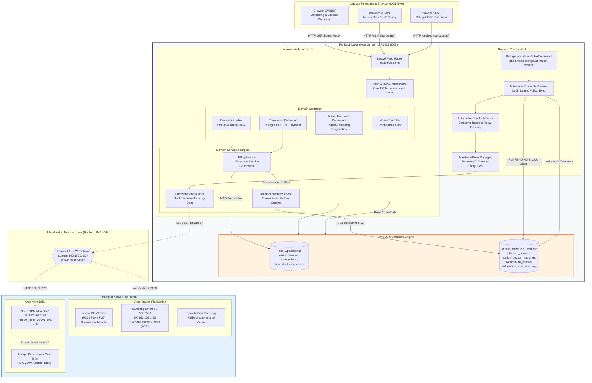

### Penjelasan Alur
1. Komputer kasir lokal bertindak sebagai host server mandiri yang menjalankan Laravel 8 dan MySQL 8 pada port `8008`.
2. Browser kasir, admin, dan owner mengakses alamat lokal `http://127.0.0.1:8008` (atau IP LAN PC kasir) melalui jaringan switch LAN/Wi-Fi toko.
3. Transaksi kasir (memulai, memperpanjang, atau menghentikan billing) diproses oleh `BillingService` dengan proteksi *pessimistic locking* (`FOR UPDATE`) di MySQL.
4. `BillingService` menyimpan sesi transaksi ke tabel `transactions` dan secara bersamaan mencatat perintah perangkat ke tabel `automation_intents` (*Transactional Outbox*).
5. Background worker `BillingAutomationWorkerCommand` berjalan terus-menerus membaca *intent* yang berstatus `PENDING` dan telah mencapai waktu eksekusi (`scheduled_at <= now()`).
6. `AutomationDispatcherService` mengevaluasi validitas generasi sesi (*fencing guard*) dan batasan kapabilitas perangkat (*capability policy*).
7. Untuk Samsung Smart TV, perintah WebSocket dikirimkan ke IP TV terdaftar. Jika belum terverifikasi fisik, policy otomatis menandai intent sebagai `SKIPPED_UNVERIFIED_CAPABILITY` agar kasir memakai remote fisik.
8. Untuk Meja Biliar, perintah HTTP RPC dikirimkan ke relay Shelly untuk menyalakan/mematikan lampu meja biliar.

### Role Pengguna
- **OWNER:** Memantau dasbor dan laporan omzet secara *read-only*.
- **ADMIN:** Mengelola data master, mendaftarkan hardware, dan mengkonfigurasi stasiun.
- **KASIR:** Mengoperasikan billing harian dan pembayaran POS FnB.

### Link Website
- Dasbor Utama: [http://127.0.0.1:8008/home](http://127.0.0.1:8008/home)
- Monitoring Dasbor Station: [http://127.0.0.1:8008/device](http://127.0.0.1:8008/device)

### Data yang Digunakan
- Model: `Device`, `Transaction`, `PhysicalDevice`, `StationDeviceMapping`, `AutomationIntent`, `AutomationExecutionLog`.
- Tabel: `devices`, `transactions`, `physical_devices`, `station_device_mappings`, `automation_intents`, `automation_execution_logs`.

### Proses Backend
- `App\Services\BillingService::startSession()`
- `App\Services\Hardware\Automation\AutomationIntentService::recordIntent()`
- `App\Console\Commands\BillingAutomationWorkerCommand::handle()`
- `App\Services\Hardware\Automation\AutomationDispatcherService::dispatchEligibleIntents()`

### Hasil Akhir
- Transaksi billing tersimpan aman di database.
- Perangkat keras fisik dikendalikan sesuai status sesi.
- Catatan audit eksekusi tersimpan secara permanen di `automation_execution_logs`.

### Kondisi Gagal
- Jika router lokal mati atau TV offline, worker mencatat error di log audit, namun transaksi kasir tetap sukses (tidak terjadi *rollback* billing).

### Status Implementasi
**IMPLEMENTED & VERIFIED** (Software & Mock E2E terverifikasi 310 tes lulus; integrasi fisik menunggu Gate G4-B2).

---

## DIAGRAM 2 — LOGIN, AUTENTIKASI & RBAC MULTI-ROLE

### Nama Proses
Autentikasi Pengguna & Penegakan Hak Akses Berbasis Peran (RBAC)

### Tujuan
Menggambarkan proses masuk pengguna ke sistem, validasi kredensial, verifikasi status peran (`owner`, `admin`, `kasir`), pembatasan akses menu, serta penegakan aturan bisnis bahwa **tidak ada fitur refund** di dalam sistem.

### Diagram Mermaid

```mermaid
flowchart TD
    StartLogin(["Pengguna Mengakses Website\nhttp://127.0.0.1:8008/login"]) --> InputForm["Form Login:\nMasukkan Email & Password"]
    InputForm --> SubmitLogin{"Klik Tombol 'Login'\nPOST /login"}

    SubmitLogin --> CheckAuth{"Validasi Kredensial\n(Hash Bcrypt)"}
    CheckAuth -- "Kredensial Salah" --> LoginFail["Kembali ke /login\nPesan Error: Kredensial tidak cocok"]
    
    CheckAuth -- "Kredensial Benar" --> EstablishSession["Buat HTTP Session Auth\nRegenerasi Session ID"]
    EstablishSession --> IdentifyRole{"Identifikasi Kolom\nusers.role"}

    %% Jalur OWNER
    IdentifyRole -- "role == 'owner'" --> OwnerDashboard["Redirect ke /home\nDasbor Eksekutif OWNER"]
    subgraph Owner_Scope["Hak Akses OWNER (Read-Only)"]
        OwnerDashboard --> OwnerM1["Melihat Omzet & Statistik Penjualan"]
        OwnerDashboard --> OwnerM2["Laporan Transaksi & Ekspor Excel/PDF"]
        OwnerDashboard --> OwnerM3["Melihat Data Perangkat / Stasiun (Read-Only)"]
        OwnerDashboard --> OwnerM4["Melihat Device Registry & Station Mapping (Read-Only)"]
        OwnerDashboard -.-> OwnerDeny["DILARANG:\n- Memulai / Menghentikan Billing\n- Mengubah Master Data / Tarif\n- Menjalankan Diagnostik IoT\n- Melakukan Refund Transaksi"]
    end

    %% Jalur ADMIN
    IdentifyRole -- "role == 'admin'" --> AdminDashboard["Redirect ke /home\nDasbor Penuh ADMIN"]
    subgraph Admin_Scope["Hak Akses ADMIN (Full Configuration)"]
        AdminDashboard --> AdminM1["Manajemen User & Shift Kasir"]
        AdminDashboard --> AdminM2["Master Playstation & Meja Biliar"]
        AdminDashboard --> AdminM3["Pengaturan Tarif Jam & Custom Package"]
        AdminDashboard --> AdminM4["Kelola FnB, Harga Kelompok & Stok"]
        AdminDashboard --> AdminM5["Device Registry, Station Mapping, Diagnostik"]
        AdminDashboard --> AdminM6["Hapus Transaksi (Hanya jika belum bayar)"]
        AdminDashboard -.-> AdminDeny["DILARANG:\n- Melakukan Refund Uang Sesi Berjalan"]
    end

    %% Jalur KASIR
    IdentifyRole -- "role == 'kasir'" --> KasirDashboard["Redirect ke /home\nDasbor Operasional KASIR"]
    subgraph Kasir_Scope["Hak Akses KASIR (Operasional Kasir)"]
        KasirDashboard --> KasirM1["Operasional Billing (Start, Extend, Stop)"]
        KasirDashboard --> KasirM2["Penjualan POS FnB & Input Pesanan"]
        KasirDashboard --> KasirM3["Proses Pembayaran (Tunai, E-Wallet, Transfer)"]
        KasirDashboard --> KasirM4["Cetak Struk Transaksi (Print Receipt)"]
        KasirDashboard --> KasirM5["Input Pengeluaran Kasir (Expense)"]
        KasirDashboard -.-> KasirDeny["DILARANG:\n- Menghapus Transaksi\n- Mengubah Master Tarif / Stok\n- Mengakses Registry & Mapping IoT\n- Melakukan Refund Transaksi"]
    end

    classDef owner fill:#e8f5e9,stroke:#2e7d32,stroke-width:1.5px;
    classDef admin fill:#e1f5fe,stroke:#0277bd,stroke-width:1.5px;
    classDef kasir fill:#fff8e1,stroke:#f57f17,stroke-width:1.5px;
    classDef deny fill:#ffebee,stroke:#c62828,stroke-width:1px;

    class OwnerDashboard,OwnerM1,OwnerM2,OwnerM3,OwnerM4 owner;
    class AdminDashboard,AdminM1,AdminM2,AdminM3,AdminM4,AdminM5,AdminM6 admin;
    class KasirDashboard,KasirM1,KasirM2,KasirM3,KasirM4,KasirM5 kasir;
    class OwnerDeny,AdminDeny,KasirDeny deny;
```

### Penjelasan Alur
1. Pengguna membuka halaman login pada URL `http://127.0.0.1:8008/login` dan memasukkan email serta password terdaftar.
2. Controller `LoginController` memvalidasi kredensial pengguna terhadap tabel `users`.
3. Setelah login berhasil, middleware `CheckRole` memeriksa peran pengguna yang tersimpan di kolom `users.role`.
4. Pengguna diarahkan ke dasbor utama `http://127.0.0.1:8008/home`. Menu pada sidebar disesuaikan secara dinamis menggunakan direktif Blade `@if(auth()->user()->isAdmin())`, `@if(auth()->user()->isKasir())`, dan `@if(auth()->user()->isOwner())`.
5. **Kebijakan Refund:** Seluruh transaksi yang telah lunas bertatus `payment_status = 'paid'` bersifat mengikat dan final. Tidak ada endpoint refund di dalam aplikasi.

### Role Pengguna
- **Semua Pengguna Terdaftar:** OWNER, ADMIN, KASIR.

### Link Website
- Halaman Login: [http://127.0.0.1:8008/login](http://127.0.0.1:8008/login)
- Dasbor Utama: [http://127.0.0.1:8008/home](http://127.0.0.1:8008/home)

### Data yang Digunakan
- Model: `App\Models\User`
- Kolom: `users.email`, `users.password`, `users.role`, `users.work_shift_id`.

### Proses Backend
- `App\Http\Controllers\Auth\LoginController::login()`
- `App\Http\Middleware\CheckRole::handle()`
- `App\Models\User::isAdmin()`, `isOwner()`, `isKasir()`.

### Hasil Akhir
- Pengguna terotentikasi memiliki sesi web aktif dan dapat melihat menu sidebar sesuai hak akses perannya.

### Kondisi Gagal
- Jika pengguna mencoba mengakses route di luar hak perannya (misal Kasir membuka `/users`), middleware melempar HTTP 403 (*Unauthorized action*).

### Status Implementasi
**IMPLEMENTED & VERIFIED**

---

## DIAGRAM 3 — PETA SITUS & NAVIGASI ANTARMUKA (WEBSITE SITEMAP)

### Nama Proses
Hierarki Navigasi Antarmuka Pengguna & Struktur Menu Website

### Tujuan
Menampilkan visualisasi seluruh menu dan sub-menu yang tersedia di antarmuka aplikasi Sugeng Rawuh berdasarkan file layout `resources/views/layouts/sidebar.blade.php` dan `routes/web.php`.

### Diagram Mermaid

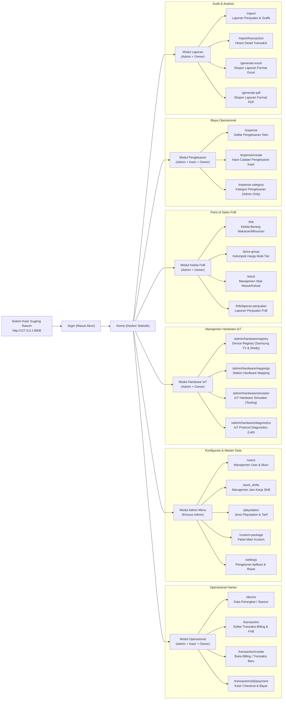

### Penjelasan Alur
1. Setelah login, pengguna diarahkan ke dasbor pusat di URL `http://127.0.0.1:8008/home`.
2. Dari dasbor, sidebar membagi navigasi menjadi 6 modul utama:
   - **Operasional:** Diakses oleh Kasir, Admin, dan Owner untuk memonitor station dan transaksi berjalan.
   - **Admin Menu:** Khusus Admin untuk pengaturan pengguna, jam kerja, jenis konsol, dan custom package.
   - **Hardware IoT:** Untuk mengelola fisik TV Samsung dan Relay Shelly, pemetaan ke stasiun, serta pengujian diagnostik.
   - **Kelola FnB:** Untuk master produk, kelompok harga, mutasi stok, dan laporan penjualan FnB.
   - **Pengeluaran:** Untuk mencatat pengeluaran kas operasional rental.
   - **Laporan:** Khusus Admin dan Owner untuk mengevaluasi omzet, tren jam sibuk, dan mengekspor dokumen laporan.

### Role Pengguna
- **OWNER, ADMIN, KASIR** (visibilitas menu disesuaikan dengan RBAC).

### Link Website
- Rangkuman Route Map: [http://127.0.0.1:8008/home](http://127.0.0.1:8008/home)

### Data yang Digunakan
- Layout Blade: `resources/views/layouts/sidebar.blade.php`, `resources/views/layouts/app.blade.php`.

### Proses Backend
- Evaluasi middleware `auth` dan `check_role` di setiap rute web.

### Hasil Akhir
- Pengguna dapat bernavigasi ke seluruh modul yang menjadi hak aksesnya secara mulus.

### Kondisi Gagal
- Klik pada menu yang dibatasi menghasilkan pesan HTTP 403 jika URL diketik manual di browser.

### Status Implementasi
**IMPLEMENTED & VERIFIED**

---

## DIAGRAM 4 — ADMIN: MANAJEMEN STATION PLAYSTATION

### Nama Proses
Pengelolaan Master Data Station PlayStation & Konfigurasi Meja

### Tujuan
Menggambarkan alur kerja ADMIN dalam membuat stasiun rental baru, menentukan jenis konsol PlayStation (PS3, PS4, PS5) atau Meja Biliar, menentukan tarif sewa per jam, serta mengatur status kesiapan perangkat.

### Diagram Mermaid

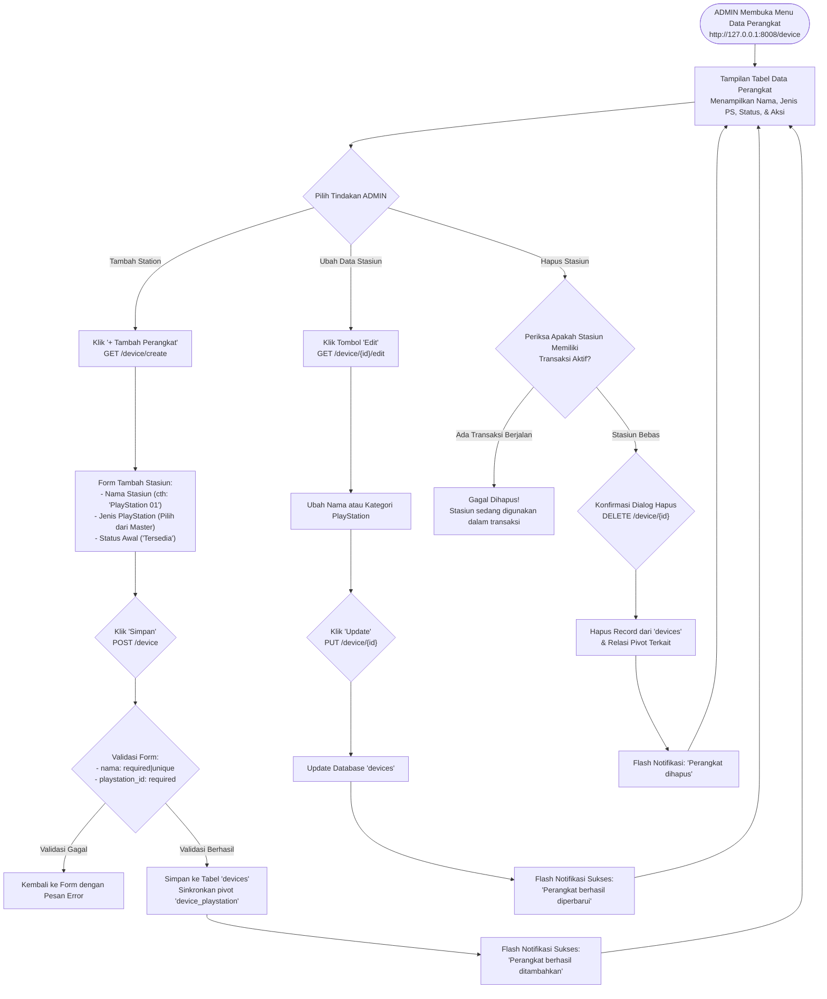

### Penjelasan Alur
1. ADMIN membuka halaman **Data Perangkat** melalui URL `http://127.0.0.1:8008/device`.
2. Untuk membuat stasiun baru, klik tombol **+ Tambah Perangkat** (`/device/create`).
3. Masukkan nama stasiun (misal `PlayStation 01`), pilih konsol dari master data jenis PlayStation (misal `PS5`), dan simpan.
4. Data stasiun disimpan ke tabel `devices` dan tabel pivot `device_playstation`.
5. Jika stasiun ingin dihapus, sistem memastikan stasiun tidak sedang memiliki transaksi billing aktif bertatus `RUNNING` untuk menjaga integritas data keuangan.

### Role Pengguna
- **ADMIN** (Penuh CRUD: Create, Read, Update, Delete).
- **KASIR & OWNER** (Read-Only: hanya melihat daftar stasiun).

### Link Website
- Daftar Stasiun: [http://127.0.0.1:8008/device](http://127.0.0.1:8008/device)
- Tambah Stasiun: [http://127.0.0.1:8008/device/create](http://127.0.0.1:8008/device/create)

### Data yang Digunakan
- Model: `App\Models\Device`, `App\Models\Playstation`.
- Tabel: `devices`, `playstations`, `device_playstation`.

### Proses Backend
- `App\Http\Controllers\DeviceController::create()`
- `App\Http\Controllers\DeviceController::store()`
- `App\Http\Controllers\DeviceController::edit()`
- `App\Http\Controllers\DeviceController::update()`
- `App\Http\Controllers\DeviceController::destroy()`

### Hasil Akhir
- Stasiun terdaftar dalam sistem dan muncul di dasbor operasional kasir untuk siap disewa.

### Kondisi Gagal
- Jika nama stasiun duplikat atau konsol tidak dipilih, validasi form mengembalikan pesan error HTTP 422.

### Status Implementasi
**IMPLEMENTED & VERIFIED**

---

## DIAGRAM 5 — ADMIN: MANAJEMEN SAMSUNG SMART TV

### Nama Proses
Pendaftaran & Registrasi Samsung Smart TV pada Device Registry

### Tujuan
Menggambarkan alur kerja ADMIN dalam mendaftarkan unit Samsung Smart TV 50U8500 ke dalam Device Registry sistem, validasi ketat brand dan MAC address, enkripsi token, hingga siap dipasangkan ke stasiun PlayStation. *(Catatan: Perangkat Coocaa ditolak otomatis oleh sistem).*

### Diagram Mermaid

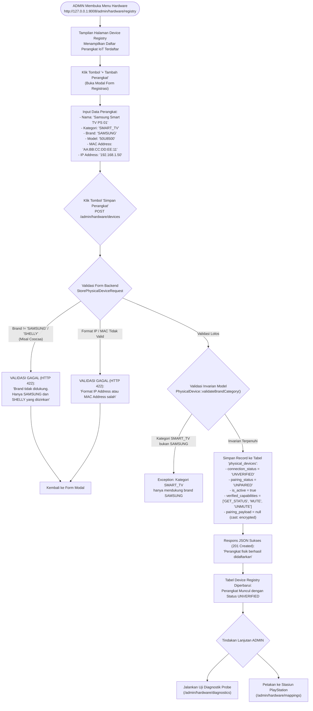

### Penjelasan Alur
1. ADMIN membuka halaman **Device Registry** di URL `http://127.0.0.1:8008/admin/hardware/registry`.
2. Klik tombol **+ Tambah Perangkat** untuk membuka form modal pendaftaran perangkat keras fisik.
3. ADMIN memasukkan nama perangkat, memilih kategori `SMART_TV`, memilih brand `SAMSUNG`, model `50U8500`, memasukkan MAC Address dari stiker/pengaturan TV, serta IP Address lokal TV.
4. Request divalidasi oleh `StorePhysicalDeviceRequest`. Jika pengguna mencoba memasukkan brand selain `SAMSUNG` atau `SHELLY` (misal Coocaa), backend langsung menolak dengan status HTTP 422.
5. Data disimpan ke tabel `physical_devices`. Status awal perangkat adalah `UNVERIFIED` dan `UNPAIRED`.
6. Kolom `pairing_payload` dilindungi dengan enkripsi AES-256 bawaan Laravel dan tersembunyi dari output JSON (`$hidden`).

### Role Pengguna
- **ADMIN** (Pendaftaran, Perubahan, Penghapusan).
- **OWNER** (Read-Only: hanya melihat daftar perangkat).

### Link Website
- Device Registry: [http://127.0.0.1:8008/admin/hardware/registry](http://127.0.0.1:8008/admin/hardware/registry)

### Data yang Digunakan
- Model: `App\Models\PhysicalDevice`.
- Tabel: `physical_devices`.
- Kolom: `name`, `category`, `brand`, `model`, `mac_address`, `ip_address`, `connection_status`, `pairing_status`, `verified_capabilities`, `pairing_payload`.

### Proses Backend
- `App\Http\Controllers\Admin\PhysicalDeviceController::store()`
- `App\Http\Requests\StorePhysicalDeviceRequest::rules()`
- `App\Models\PhysicalDevice::validateBrandCategory()`

### Hasil Akhir
- Samsung Smart TV resmi terdaftar dalam registry dan siap untuk dipasangkan ke station PlayStation.

### Kondisi Gagal
- Jika IP Address atau MAC Address sudah terdaftar untuk perangkat lain, validasi *unique* menggagalkan penyimpanan.

### Status Implementasi
**IMPLEMENTED & VERIFIED**

---

## DIAGRAM 6 — SEKUEN KONEKSI & PAIRING SAMSUNG SMART TV

### Nama Proses
Protokol Komunikasi Jaringan, Probe, & Pairing Handshake Samsung Smart TV

### Tujuan
Menggambarkan urutan pertukaran pesan antara antarmuka Admin, backend Laravel, driver Samsung, router lokal, dan televisi fisik Samsung melalui protokol HTTP REST (port 8001) dan Secure WebSocket (port 8002).

### Diagram Mermaid

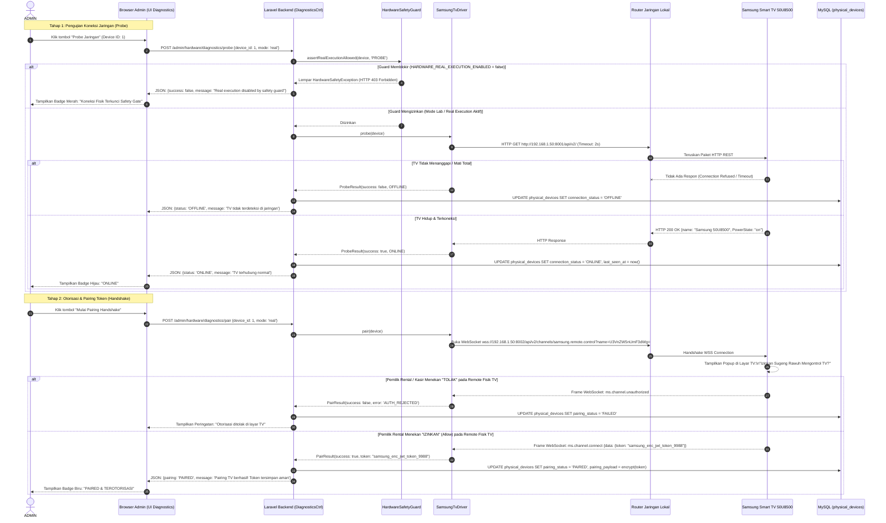

### Penjelasan Alur
1. **Probe (Pemeriksaan Jaringan):** Admin menguji keterjangkauan TV melalui REST API port 8001. Driver mengirim HTTP GET ke endpoint `/api/v2/`. Jika TV merespons dalam 2 detik, status di database diperbarui menjadi `ONLINE`.
2. **Pairing Handshake:** Admin memicu proses pairing melalui antarmuka diagnostik.
3. Backend membuka koneksi aman WebSocket (*Secure WebSocket* wss) ke port 8002 TV Samsung dengan menyertakan nama aplikasi yang telah di-encode Base64 (`SugengRawuh`).
4. Di layar TV Samsung, muncul prompt pop-up perizinan akses remote.
5. Admin menekan tombol **Izinkan (Allow)** menggunakan remote fisik bawaan TV.
6. TV mengirimkan frame JSON `ms.channel.connect` yang memuat token otentikasi permanen.
7. Backend menangkap token tersebut, mengenkripsinya dengan `Crypt::encryptString()`, dan menyimpannya di kolom `physical_devices.pairing_payload`.
8. Status pairing berubah menjadi `PAIRED`.

### Role Pengguna
- **ADMIN** (Menjalankan probe dan pairing di lab diagnostik).

### Link Website
- Hardware Diagnostics: [http://127.0.0.1:8008/admin/hardware/diagnostics](http://127.0.0.1:8008/admin/hardware/diagnostics)

### Data yang Digunakan
- Model: `App\Models\PhysicalDevice`.
- Endpoint TV: `http://{ip}:8001/api/v2/` dan `wss://{ip}:8002/api/v2/channels/samsung.remote.control`.

### Proses Backend
- `App\Http\Controllers\Admin\HardwareDiagnosticsController::probe()`
- `App\Http\Controllers\Admin\HardwareDiagnosticsController::pair()`
- `App\Services\Hardware\Drivers\SamsungTvDriver::probe()`
- `App\Services\Hardware\Drivers\SamsungTvDriver::pair()`

### Hasil Akhir
- Token tersimpan aman di database terenkripsi, status koneksi TV tercatat `ONLINE`, dan pairing tercatat `PAIRED`.

### Kondisi Gagal
- Jika TV dimatikan dari saklar atau IP berubah, probe menghasilkan timeout dan status otomatis menjadi `OFFLINE`.

### Status Implementasi
**PHYSICAL VERIFICATION PENDING** (Software driver riil dan fake mock selesai; pengujian fisik menunggu Gate G4-B2).

---

## DIAGRAM 7 — KASIR: BILLING PREPAID PLAYSTATION

### Nama Proses
Alur Operasional Billing Paket Jam (Prepaid) PlayStation oleh Kasir

### Tujuan
Menggambarkan alur kerja petugas kasir saat melayani pelanggan rental PlayStation dengan sistem bayar di muka (prepaid), pembuatan sesi server-side, penjadwalan otomatisasi outbox, penanganan kemampuan TV Samsung, hingga masa sewa habis.

### Diagram Mermaid

```mermaid
flowchart TD
    KasirStart(["Pelanggan Datang Memesan PlayStation"]) --> KasirNav["Kasir Membuka Dasbor Stasiun\nhttp://127.0.0.1:8008/device"]
    
    KasirNav --> SelectStation["Kasir Memilih Stasiun Tersedia\n(Contoh: 'PlayStation 01' - Status: 'Tersedia')"]
    SelectStation --> ClickStart["Klik Tombol 'Mulai Billing'\n(Buka Form Transaksi Rental)"]
    
    ClickStart --> InputPrepaid["Pilih Jenis: 'Paket Jam (Prepaid)'\n- Pilih Durasi: 1 Jam, 2 Jam, dst.\n- Input Nama Pelanggan (Opsional)\n- Input Tambahan FnB (Opsional)"]
    
    InputPrepaid --> SubmitBilling{"Kasir Klik 'Mulai Rental'\nPOST /device/start"}
    
    SubmitBilling --> DB_Lock["BillingService: Lock Stasiun 'devices'\nSELECT ... FOR UPDATE"]
    DB_Lock --> CheckAvail{"Cek Ketersediaan Stasiun\n(status == 'Tersedia')"}
    
    CheckAvail -- "Stasiun Tidak Tersedia" --> AbortStart["Batalkan Transaksi!\nKembalikan Error: Stasiun sedang digunakan"]
    
    CheckAvail -- "Stasiun Tersedia" --> CalcTime["Kalkulasi Waktu Absolut Server:\n- started_at = now()\n- expires_at = now() + durasi\n- waktu_Selesai = expires_at.format('H:i')\n- total = tarif_per_jam * durasi"]
    
    CalcTime --> AtomicTx["Simpan Transaksi ke 'transactions':\n- billing_status = 'RUNNING'\n- tipe_transaksi = 'prepaid'\n- payment_status = 'unpaid'\nUpdate Stasiun: status = 'Digunakan'\nIncrement: session_generation += 1"]
    
    AtomicTx --> CreateOutbox["AutomationIntentService: Catat Outbox Intent\n1. Intent STARTED (Desired: ON, Scheduled: now())\n2. Intent EXPIRED (Desired: OFF, Scheduled: expires_at)"]
    
    CreateOutbox --> KasirView["Layar Kasir Menampilkan Timer Aktif:\n- Status: DIGUNAKAN (Warna Merah)\n- Hitung Mundur Sisa Waktu Berjalan"]

    %% Jalur Otomasi Background
    CreateOutbox -.-> WorkerLoop["Background Worker Memproses Intent STARTED"]
    WorkerLoop --> EvalPolicy{"Evaluasi AutomationCapabilityPolicy\nuntuk Samsung Smart TV"}
    EvalPolicy -- "Perintah Daya Belum Terverifikasi Fisik" --> SkipPower["Tandai Intent: SKIPPED_UNVERIFIED_CAPABILITY\nCatat Audit Log (Tidak Mengirim Sinyal Bahaya)"]
    SkipPower --> KasirManualAction["KASIR MENYALAKAN TV:\nKasir Menekan Tombol Power pada Remote Fisik Samsung"]

    %% Siklus Waktu Berjalan
    KasirView --> TimeElapses["Pelanggan Bermain Game...\nWaktu Bergerak Menuju Expiration"]
    TimeElapses --> TimeExpired{"Waktu Server Mencapai expires_at\n(evaluated by worker)"}

    TimeExpired --> ProcessExpiry["BillingService::evaluateExpiration():\n- Update Transaksi: billing_status = 'EXPIRED_PENDING_ACTION'\n- Update Transaksi: status_transaksi = 'selesai'\n- Update Stasiun: status = 'Tersedia'"]
    
    ProcessExpiry --> AlertKasir["Layar Kasir Berbunyi / Menampilkan Notifikasi:\n'WAKTU HABIS - STASIUN PLAYSTATION 01'"]
    AlertKasir --> KasirRemoteOff["Kasir Mematikan TV Menggunakan Remote Fisik Samsung\n(Atau Menawarkan Perpanjangan Waktu)"]
```

### Penjelasan Alur
1. Kasir membuka menu **Data Perangkat** di URL `http://127.0.0.1:8008/device`.
2. Kasir memilih stasiun PlayStation yang berstatus **Tersedia** (berwarna hijau).
3. Pada form transaksi, kasir memilih jenis transaksi **prepaid**, menentukan durasi main (misal 2 jam), dan klik **Mulai Rental**.
4. `BillingService::startSession()` mengunci baris stasiun dengan *pessimistic lock*, menghitung `started_at` dan `expires_at` berdasarkan jam server, menyimpan transaksi dengan status `RUNNING`, serta menaikkan nilai `session_generation` stasiun.
5. Dua intent outbox dibuat secara atomik: `BILLING_STARTED` (segera) dan `BILLING_EXPIRED` (dijadwalkan pada `expires_at`).
6. Worker membaca intent `BILLING_STARTED`. Karena TV Samsung memiliki sifat remote *toggle*, `AutomationCapabilityPolicy` menandai intent sebagai `SKIPPED_UNVERIFIED_CAPABILITY`. Kasir menyalakan TV menggunakan remote fisik.
7. Ketika waktu sewa habis di server, worker mengubah status sesi menjadi `EXPIRED_PENDING_ACTION`. Stasiun menjadi `Tersedia` dan kasir menagih pembayaran jika belum lunas.

### Role Pengguna
- **KASIR** (Melakukan input dan konfirmasi billing).

### Link Website
- Dasbor Operasional Stasiun: [http://127.0.0.1:8008/device](http://127.0.0.1:8008/device)

### Data yang Digunakan
- Model: `Device`, `Transaction`, `AutomationIntent`.
- Kolom: `transactions.billing_status`, `transactions.started_at`, `transactions.expires_at`, `devices.session_generation`.

### Proses Backend
- `App\Http\Controllers\DeviceController::index()`
- `App\Services\BillingService::startSession()`
- `App\Services\Hardware\Automation\AutomationIntentService::recordIntent()`
- `App\Services\BillingService::evaluateExpiration()`

### Hasil Akhir
- Sesi sewa terdaftar resmi, jam mulai dan jam selesai tercatat akurat, stasiun berstatus merah (Digunakan).

### Kondisi Gagal
- Jika kasir lain mencoba memulai stasiun yang sama secara bersamaan, *pessimistic lock* menggagalkan transaksi kedua dengan notifikasi stasiun tidak tersedia.

### Status Implementasi
**IMPLEMENTED & VERIFIED**

---

## DIAGRAM 8 — KASIR: BILLING LOST TIME (POSTPAID) PLAYSTATION

### Nama Proses
Alur Operasional Billing Bebas Waktu (Lost Time / Postpaid) PlayStation

### Tujuan
Menggambarkan alur sewa tanpa batasan durasi di awal, di mana durasi berjalan dihitung secara progresif oleh server hingga pelanggan memutuskan selesai main, lalu kasir menekan tombol Stop untuk kalkulasi biaya akhir.

### Diagram Mermaid

```mermaid
flowchart TD
    StartLostTime(["Pelanggan Datang Meminta 'Main Sepuasnya' (Lost Time)"]) --> KasirNav["Kasir Membuka Dasbor Stasiun\nhttp://127.0.0.1:8008/device"]
    
    KasirNav --> SelectStation["Kasir Memilih Stasiun Tersedia\n(Contoh: 'PlayStation 02')"]
    SelectStation --> ChoosePostpaid["Pilih Jenis Billing: 'Lost Time (Postpaid)'\n- Input Nama Pelanggan\n- Tarif Dasar Per Jam Ditampilkan"]
    
    ChoosePostpaid --> SubmitStart{"Kasir Klik 'Mulai Main'\nPOST /device/start"}
    
    SubmitStart --> DB_Lock["BillingService: Lock Stasiun 'devices'\nSELECT ... FOR UPDATE"]
    DB_Lock --> SavePostpaid["Simpan Transaksi 'transactions':\n- tipe_transaksi = 'postpaid'\n- billing_status = 'RUNNING'\n- started_at = now()\n- lost_time_start = now()\n- expires_at = NULL (Tidak Ada Expiry)\n- status_transaksi = 'berjalan'\nUpdate Stasiun: status = 'Digunakan'"]
    
    SavePostpaid --> StartIntent["AutomationIntentService: Catat Intent\nEvent: BILLING_STARTED (State: ON)"]
    
    StartIntent --> KasirTimer["Layar Kasir Menampilkan Stopwatch Berjalan:\n- Durasi Bertambah: 00:01, 00:02, dst.\n- Indikator: LOST TIME AKTIF"]

    KasirTimer --> PlayingSession["Pelanggan Bermain Bebas...\n(Bisa Pesan FnB Tambahan Kapan Saja)"]

    PlayingSession --> CustomerDone(["Pelanggan Datang ke Kasir: 'Selesai Main'"])
    CustomerDone --> ClickStop["Kasir Klik Tombol 'Stop'\nPOST /device/{id}/stop"]

    ClickStop --> LockStopSession["BillingService::stopSession():\nLock Transaksi & Stasiun"]
    LockStopSession --> CalcDuration["Hitung Durasi Aktual:\nduration_minutes = diffInMinutes(started_at, now())"]
    
    CalcDuration --> CalcPrice["Kalkulasi Tarif Lost Time:\n- Hitung Biaya Proporsional Per Menit\n- Terapkan Pembulatan Tarif (Lost Time Rounding)\n- Tambahkan Total Pesanan FnB\n- Format: 'X jam Y menit'"]

    CalcPrice --> FinalizeTx["Update Transaksi:\n- billing_status = 'COMPLETED'\n- status_transaksi = 'selesai'\n- ended_at = now()\n- total = tarif_ps + total_fnb\nUpdate Stasiun: status = 'Tersedia'"]

    FinalizeTx --> StopIntent["AutomationIntentService: Catat Intent\nEvent: BILLING_STOPPED (State: OFF)"]
    
    StopIntent --> RedirectPayment["Redirect Kasir ke Halaman Pembayaran:\nGET /transaction/{id}/payment\nMenampilkan Rincian Tagihan Akhir"]
```

### Penjelasan Alur
1. Kasir memilih stasiun yang tersedia dan memilih opsi billing **Lost Time (Postpaid)**.
2. `BillingService::startSession()` menginisialisasi transaksi dengan nilai `expires_at = null`, `status_transaksi = 'berjalan'`, dan mencatat `lost_time_start`.
3. Timer di dasbor kasir bertindak sebagai penghitung maju (*stopwatch*).
4. Pelanggan dapat bermain tanpa batas waktu dan memesan makanan/minuman yang langsung ditambahkan ke tagihan sesi berjalan.
5. Ketika pelanggan selesai, kasir menekan tombol **Stop** pada stasiun tersebut.
6. `BillingService::stopSession()` menghitung selisih menit antara `started_at` dan waktu selesai saat ini, mengalikan dengan tarif per menit, menerapkan aturan pembulatan resmi rental, menambahkan tagihan FnB, dan menandai transaksi `COMPLETED`.
7. Sistem langsung mengarahkan kasir ke halaman pembayaran (`/transaction/{id}/payment`).

### Role Pengguna
- **KASIR** (Memulai dan menghentikan sesi Lost Time).

### Link Website
- Dasbor Stasiun: [http://127.0.0.1:8008/device](http://127.0.0.1:8008/device)
- Halaman Pembayaran: [http://127.0.0.1:8008/transaction/{id}/payment](http://127.0.0.1:8008/transaction/{id}/payment)

### Data yang Digunakan
- Model: `Transaction`, `Device`, `Playstation`.
- Kolom: `transactions.lost_time_start`, `transactions.started_at`, `transactions.ended_at`, `transactions.total`.

### Proses Backend
- `App\Services\BillingService::startSession()`
- `App\Services\BillingService::stopSession()`
- `App\Services\BillingService::calculateLostTimePrice()`
- `App\Services\BillingService::applyLostTimeRounding()`

### Hasil Akhir
- Durasi total dan tagihan final terhitung otomatis tanpa risiko kesalahan hitung manual oleh kasir.

### Kondisi Gagal
- Jika kasir menekan Stop dua kali berturut-turut, proteksi idempoten di `stopSession()` memastikan kalkulasi biaya tidak terduplikasi.

### Status Implementasi
**IMPLEMENTED & VERIFIED**

---

## DIAGRAM 9 — KASIR: PERPANJANGAN WAKTU (EXTEND) & PENGHENTIAN DINI (STOP SESSION)

### Nama Proses
Manajemen Sesi Berjalan: Perpanjangan Waktu (Extend) & Selesai Lebih Awal (Stop Early)

### Tujuan
Menggambarkan logika internal sistem saat kasir menambah waktu sewa (extend) atau menghentikan sesi sewa sebelum waktunya habis (stop early), pembatalan intent lama, peningkatan *session generation*, dan pencegahan *stale commands* agar stasiun tidak mati tiba-tiba pada pelanggan berikutnya.

### Diagram Mermaid

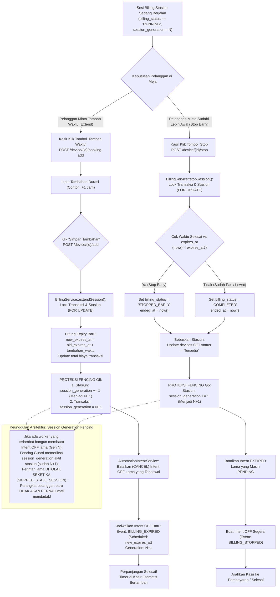

### Penjelasan Alur
1. **Perpanjangan Waktu (Extend):**
   - Kasir memilih stasiun aktif dan menginput tambahan jam sewa.
   - `BillingService::extendSession()` menghitung waktu berakhir baru (`new_expires_at = old_expires_at + tambahan`).
   - Sistem menaikkan *session generation* stasiun secara atomik (`session_generation = N + 1`).
   - Intent matikan perangkat lama yang berstatus `PENDING` otomatis dibatalkan (`CANCELLED`).
   - Dibuat intent matikan baru yang dijadwalkan pada waktu kedaluwarsa baru (`new_expires_at`).
2. **Penghentian Dini (Stop Early):**
   - Jika pelanggan berhenti sebelum paket habis, kasir menekan tombol **Stop**.
   - `BillingService::stopSession()` menetapkan status sesi menjadi `STOPPED_EARLY`, menaikkan *session generation* stasiun, dan membatalkan jadwal mati lama.
3. **Pencegahan Perintah Basi (*Stale Command Protection*):**
   - Setiap generasi stasiun dijamin unik. Jika worker mengalami *lag* dan mencoba mengeksekusi instruksi dari sesi sebelumnya, `AutomationFencingGuard` membandingkan generasi sesi dan membatalkan eksekusi, menjamin pelanggan berikutnya tidak terganggu.

### Role Pengguna
- **KASIR** (Melakukan extend dan stop manual).

### Link Website
- Dasbor Stasiun: [http://127.0.0.1:8008/device](http://127.0.0.1:8008/device)

### Data yang Digunakan
- Model: `Transaction`, `Device`, `AutomationIntent`.
- Kolom: `devices.session_generation`, `transactions.session_generation`, `automation_intents.session_generation`.

### Proses Backend
- `App\Services\BillingService::extendSession()`
- `App\Services\BillingService::stopSession()`
- `App\Services\Hardware\Automation\AutomationFencingGuard::validateIntent()`

### Hasil Akhir
- Transaksi diperbarui secara akurat, intent lama dibersihkan, dan kontinuitas daya listrik stasiun terproteksi 100%.

### Kondisi Gagal
- Sesi yang sudah bertatus `COMPLETED` atau `STOPPED_EARLY` tidak dapat diperpanjang kembali.

### Status Implementasi
**IMPLEMENTED & VERIFIED**

---

## DIAGRAM 10 — OTOMATISASI MEJA BILIAR & SHELLY RELAY

### Nama Proses
Otomatisasi Lampu Meja Biliar Berdasarkan Keputusan Bisnis SR-G5-BR-001

### Tujuan
Menggambarkan integrasi antara sesi rental meja biliar dan Smart Relay Shelly 1PM Mini Gen3, di mana lampu meja biliar otomatis menyala saat mulai dan **langsung mati seketika tanpa masa tenggang saat waktu habis**.

### Diagram Mermaid

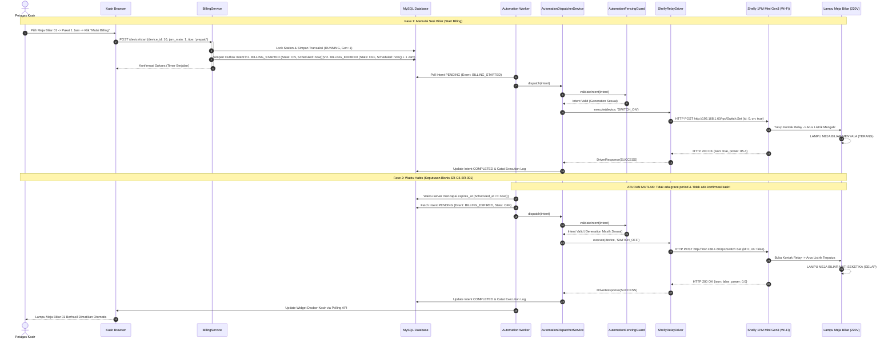

### Penjelasan Alur
1. Kasir memulai sesi prepaid meja biliar.
2. `BillingService` membuat transaksi dan dua intent outbox: `BILLING_STARTED` (segera) dan `BILLING_EXPIRED` (pada saat waktu sewa habis).
3. Background worker membaca intent `BILLING_STARTED`, memanggil `ShellyRelayDriver`, dan mengirimkan request HTTP JSON-RPC 2.0 ke modul Shelly di IP `192.168.1.60` (`Switch.Set` with `on: true`).
4. Relay Shelly menutup kontak saklar listrik dan lampu meja biliar menyala terang.
5. **Penegakan Keputusan Bisnis SR-G5-BR-001:** Saat jam server mencapai waktu kedaluwarsa, worker mengambil intent `BILLING_EXPIRED` dan mengirimkan `Switch.Set` with `on: false`.
6. Lampu meja biliar **langsung mati seketika**, memastikan tidak ada pelanggan yang bermain melebihi batas waktu yang telah dibayar.
7. Kasir melihat status stasiun kembali `Tersedia` pada dasbor.

### Role Pengguna
- **KASIR** (Memulai billing meja biliar).
- **AUTOMATION WORKER** (Mengeksekusi perintah ON/OFF relay secara otonom).

### Link Website
- Dasbor Stasiun Biliar: [http://127.0.0.1:8008/device](http://127.0.0.1:8008/device)
- Telemetri Log Otomasi: [http://127.0.0.1:8008/admin/hardware/automation/logs](http://127.0.0.1:8008/admin/hardware/automation/logs)

### Data yang Digunakan
- Model: `Device`, `StationDeviceMapping`, `PhysicalDevice`, `AutomationIntent`.
- Protokol: Shelly Gen3 HTTP JSON-RPC 2.0 (`/rpc/Switch.Set`).

### Proses Backend
- `App\Services\Hardware\Drivers\ShellyRelayDriver::switchOn()`
- `App\Services\Hardware\Drivers\ShellyRelayDriver::switchOff()`
- `App\Services\Hardware\Automation\AutomationDispatcherService::execute()`

### Hasil Akhir
- Pengendalian lampu meja biliar berlangsung otomatis 100% tepat waktu tanpa intervensi manual kasir.

### Kondisi Gagal
- Jika Shelly relay kehilangan sinyal Wi-Fi, worker mencoba retry hingga batas `max_attempts` dan mencatat status `FAILED` di log audit tanpa menghentikan billing kasir.

### Status Implementasi
**IMPLEMENTED & VERIFIED (SOFTWARE MOCK)**; Integrasi perangkat keras fisik nyata menunggu Gate G4-B2.

---

## DIAGRAM 11 — POS F&B TRANSACTION FLOW

### Nama Proses
Alur Transaksi Penjualan Makanan & Minuman (Point of Sales FnB)

### Tujuan
Menggambarkan alur kasir dalam menginput pesanan makanan/minuman, memilih produk, memeriksa ketersediaan stok secara atomik, mencatat mutasi stok keluar, serta menggabungkan pesanan ke dalam transaksi billing atau sebagai pesanan tersendiri.

### Diagram Mermaid

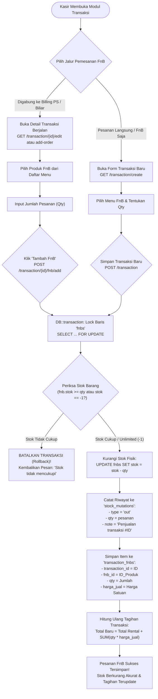

### Penjelasan Alur
1. Kasir dapat menjual makanan/minuman melalui dua jalur:
   - **Jalur Terintegrasi:** Menambahkan FnB ke sesi billing yang sedang berjalan (`POST /transaction/{id}/fnb/add`).
   - **Jalur Langsung:** Menjual FnB sebagai transaksi kasir tersendiri (`POST /transaction`).
2. Backend mengunci baris produk di tabel `fnbs` dengan *pessimistic lock* (`SELECT ... FOR UPDATE`).
3. Sistem memeriksa apakah stok mencukupi (jika stok `-1`, artinya barang *unlimited* atau tidak dibatasi kuantitasnya).
4. Jika stok cukup, kuantitas stok dikurangi secara atomik di tabel `fnbs`.
5. Tercatat rekaman audit mutasi stok keluar di tabel `stock_mutations`.
6. Record pesanan disimpan di tabel `transaction_fnbs` dan total tagihan transaksi dihitung ulang.

### Role Pengguna
- **KASIR & ADMIN** (Input pesanan dan transaksi).

### Link Website
- Transaksi Baru: [http://127.0.0.1:8008/transaction/create](http://127.0.0.1:8008/transaction/create)
- Manajemen FnB: [http://127.0.0.1:8008/fnb](http://127.0.0.1:8008/fnb)
- Manajemen Stok: [http://127.0.0.1:8008/stock](http://127.0.0.1:8008/stock)

### Data yang Digunakan
- Model: `Fnb`, `TransactionFnb`, `StockMutation`, `Transaction`.
- Tabel: `fnbs`, `transaction_fnbs`, `stock_mutations`, `transactions`.

### Proses Backend
- `App\Http\Controllers\TransactionController::addFnbToTransaction()`
- `App\Http\Controllers\TransactionController::storeOrder()`
- `App\Models\StockMutation::create()`

### Hasil Akhir
- Item FnB masuk ke rincian struk, total tagihan terakumulasi, dan inventaris barang toko langsung terpotong.

### Kondisi Gagal
- Jika kuantitas pesanan melebihi sisa stok di database, transaksi otomatis dibatalkan (*rollback*) dengan pesan peringatan.

### Status Implementasi
**IMPLEMENTED & VERIFIED**

---

## DIAGRAM 12 — ALUR PEMBAYARAN, CHECKOUT, & CETAK STRUK (RECEIPT)

### Nama Proses
Checkout Tagihan, Validasi Pembayaran Multi-Metode, & Pencetakan Struk Transaksi

### Tujuan
Menggambarkan alur kasir dalam memproses pembayaran akhir pelanggan (sewa konsol + FnB), validasi nominal bayar, pencatatan metode pembayaran (`tunai`, `e-wallet`, `transfer_bank`), dan pencetakan struk transaksi kasir.

### Diagram Mermaid

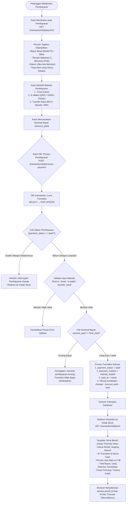

### Penjelasan Alur
1. Kasir membuka halaman pembayaran di URL `http://127.0.0.1:8008/transaction/{id}/payment`.
2. Halaman menampilkan rincian biaya: durasi sewa, rincian makanan/minuman yang dikonsumsi, diskon member (jika ada), dan total tagihan.
3. Kasir memilih salah satu dari 3 metode pembayaran resmi: **tunai**, **e-wallet**, atau **transfer_bank**.
4. Kasir memasukkan nominal uang yang diterima dari pelanggan.
5. `TransactionController::processPayment()` mengunci baris transaksi, memastikan transaksi belum pernah dibayar sebelumnya, memvalidasi kecukupan uang, dan menghitung nominal kembalian (*change*).
6. Status transaksi diubah menjadi `payment_status = 'paid'` dan `paid_at = now()`.
7. Setelah commit database berhasil, kasir otomatis diarahkan ke URL `http://127.0.0.1:8008/transaction/{id}/print`.
8. Tampilan struk bersih (*thermal-friendly*) langsung memicu dialog pencetakan browser (`window.print()`) ke printer kasir (58mm / 80mm).

### Role Pengguna
- **KASIR & ADMIN** (Memproses pembayaran dan mencetak struk).

### Link Website
- Form Pembayaran: [http://127.0.0.1:8008/transaction/{id}/payment](http://127.0.0.1:8008/transaction/{id}/payment)
- Cetak Struk: [http://127.0.0.1:8008/transaction/{id}/print](http://127.0.0.1:8008/transaction/{id}/print)

### Data yang Digunakan
- Model: `Transaction`, `TransactionFnb`.
- Kolom: `transactions.payment_status`, `transactions.payment_method`, `transactions.paid_at`, `transactions.total`.

### Proses Backend
- `App\Http\Controllers\TransactionController::showPayment()`
- `App\Http\Controllers\TransactionController::processPayment()`
- `App\Http\Controllers\TransactionController::printReceipt()`

### Hasil Akhir
- Pembayaran tercatat lunas di pembukuan dan struk belanja fisik berhasil dicetak untuk pelanggan.

### Kondisi Gagal
- Jika jumlah uang yang dimasukkan kurang dari total tagihan, sistem menolak dan menampilkan peringatan nominal pembayaran kurang.

### Status Implementasi
**IMPLEMENTED & VERIFIED**

---

## DIAGRAM 13 — LAPORAN KEUANGAN & AUDIT OPERASIONAL (OWNER & ADMIN)

### Nama Proses
Pemantauan Pendapatan, Laporan Penjualan, & Ekspor Data Keuangan (OWNER & ADMIN)

### Tujuan
Menggambarkan bagaimana OWNER dan ADMIN memantau performa bisnis rental, melihat grafik pendapatan per jam, mengevaluasi histori transaksi, memantau utilisasi stasiun, serta mencetak laporan ke format PDF dan Excel.

### Diagram Mermaid

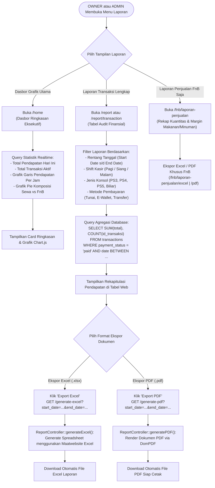

### Penjelasan Alur
1. OWNER atau ADMIN mengakses menu laporan melalui dasbor `http://127.0.0.1:8008/home` atau menu laporan di `http://127.0.0.1:8008/report`.
2. Dasbor menyajikan ringkasan omzet harian, jumlah stasiun terpakai, grafik pendapatan per jam, dan perbandingan omzet rental vs FnB.
3. Pada halaman detail laporan transaksi (`/report/transaction`), pengguna dapat memfilter transaksi berdasarkan rentang tanggal, shift kerja kasir, dan metode pembayaran.
4. Data laporan dapat diunduh kapan saja ke dalam format **Excel** (`/generate-excel`) atau **PDF** (`/generate-pdf`).
5. Modul FnB juga menyediakan laporan penjualan mandiri (`/fnb/laporan-penjualan`) untuk melihat barang terlaris dan mutasi sisa stok.

### Role Pengguna
- **OWNER & ADMIN** (Diberikan akses penuh melihat dan mengekspor seluruh laporan keuangan).
- **KASIR** (Tidak memiliki akses ke menu laporan keseluruhan omzet toko).

### Link Website
- Dasbor Omzet: [http://127.0.0.1:8008/home](http://127.0.0.1:8008/home)
- Laporan Penjualan: [http://127.0.0.1:8008/report](http://127.0.0.1:8008/report)
- Laporan FnB: [http://127.0.0.1:8008/fnb/laporan-penjualan](http://127.0.0.1:8008/fnb/laporan-penjualan)

### Data yang Digunakan
- Model: `Transaction`, `TransactionFnb`, `Expense`, `WorkShift`.
- Tabel: `transactions`, `transaction_fnbs`, `expenses`, `work_shifts`.

### Proses Backend
- `App\Http\Controllers\HomeController::index()`
- `App\Http\Controllers\HomeController::hourlyRevenueData()`
- `App\Http\Controllers\ReportController::index()`
- `App\Http\Controllers\ReportController::generateExcel()`
- `App\Http\Controllers\ReportController::generatePDF()`

### Hasil Akhir
- Transparansi pembukuan kasir terjamin dan pemilik bisnis (Owner) dapat memantau performa usaha kapan saja.

### Kondisi Gagal
- Jika rentang tanggal filter terbalik (tanggal akhir lebih kecil dari tanggal mulai), sistem menampilkan pesan validasi filter tidak valid.

### Status Implementasi
**IMPLEMENTED & VERIFIED**

---

## DIAGRAM 14 — PENANGANAN KEGAGALAN HARDWARE & PEMULIHAN OFFLINE (FAILURE RECOVERY)

### Nama Proses
Prosedur Penanganan Error Jaringan, Kegagalan Hardware, & Pemulihan Operasional Kasir

### Tujuan
Menggambarkan bagaimana sistem Sugeng Rawuh menangani berbagai skenario kegagalan: Samsung TV offline, koneksi WebSocket timeout, relay biliar mati, worker terhenti, atau database error, serta prosedur pemulihan (*failover*) agar operasional kasir tetap berjalan lancar.

### Diagram Mermaid

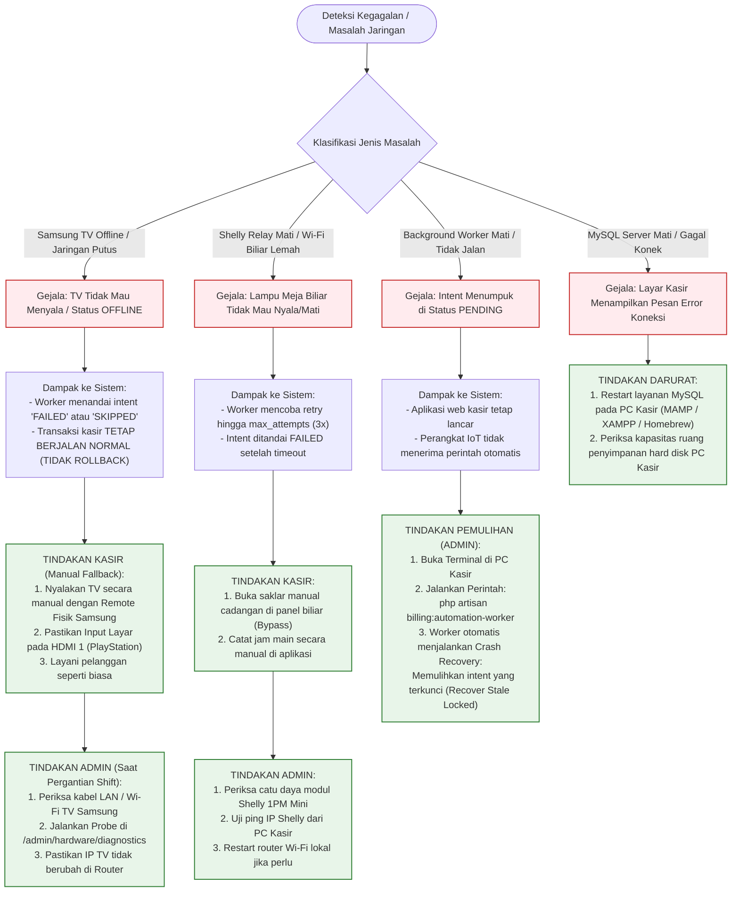

### Penjelasan Alur
1. **Kegagalan TV Samsung:** Karena TV dikendalikan melalui jaringan IP lokal, jika TV offline, transaksi kasir **tidak pernah dibatalkan**. Kasir langsung menyalakan TV secara manual dengan remote fisik. Admin kemudian memeriksa kabel LAN/Wi-Fi dan status router saat pergantian shift.
2. **Kegagalan Relay Shelly Meja Biliar:** Jika relay offline, worker mencoba mengirim ulang hingga 3 kali (*retry backoff*). Jika tetap gagal, error dicatat di log audit. Kasir dapat menyalakan saklar manual cadangan di panel meja biliar.
3. **Kegagalan Background Worker:** Jika proses daemon worker di terminal PC kasir terhenti, aplikasi kasir tetap bisa beroperasi normal. Admin cukup menjalankan kembali perintah `php artisan billing:automation-worker`. Saat *booting*, worker otomatis mengeksekusi mekanisme *Crash Recovery* untuk memulihkan intent yang tertunda.
4. **Prinsip Keselamatan Utama:** Sistem tidak pernah memutus listrik konsol PlayStation atau TV menggunakan relay daya darurat guna melindungi mesin dari kerusakan internal.

### Role Pengguna
- **KASIR & ADMIN** (Menjalankan prosedur *recovery* operasional).

### Link Website
- Log Audit Error Otomasi: [http://127.0.0.1:8008/admin/hardware/automation/logs](http://127.0.0.1:8008/admin/hardware/automation/logs)
- Halaman Diagnostik: [http://127.0.0.1:8008/admin/hardware/diagnostics](http://127.0.0.1:8008/admin/hardware/diagnostics)

### Data yang Digunakan
- Tabel: `automation_execution_logs`, `automation_intents`.
- Kolom: `automation_execution_logs.error_category`, `automation_execution_logs.error_details`.

### Proses Backend
- `App\Services\Hardware\Automation\AutomationDispatcherService::recoverStaleLockedIntents()`
- `App\Services\Hardware\Security\HardwareSafetyGuard`

### Hasil Akhir
- Operasional rental tetap berjalan lancar tanpa kehilangan data transaksi meskipun perangkat keras mengalami gangguan jaringan.

### Kondisi Gagal
- Jika seluruh jaringan LAN toko mati total, kasir tetap dapat mengoperasikan billing dari browser lokal `http://127.0.0.1:8008` di PC kasir.

### Status Implementasi
**IMPLEMENTED & VERIFIED**

---

## DIAGRAM TAMBAHAN

### Diagram 15 — State Machine Siklus Hidup Billing (Billing Lifecycle State Machine)

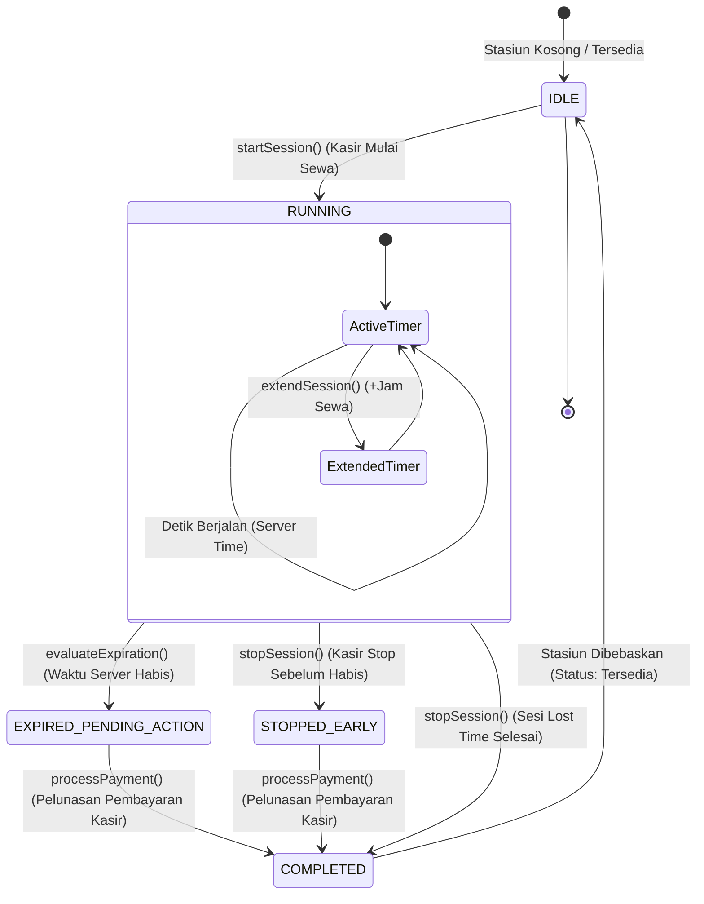

---

### Diagram 16 — Alur Transactional Outbox Pattern (Transactional Outbox Sequence)

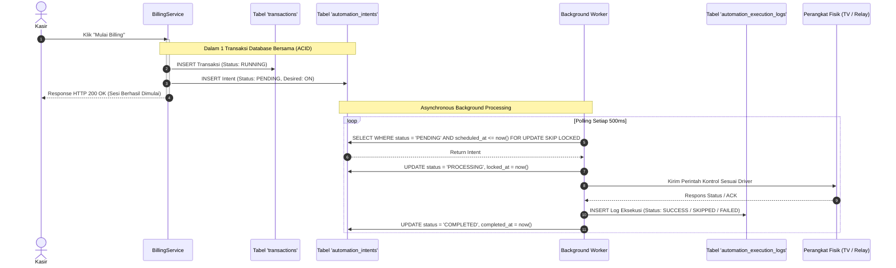

---

### Diagram 17 — Entity Relationship Diagram (ERD Relasi Billing, Stasiun & IoT)

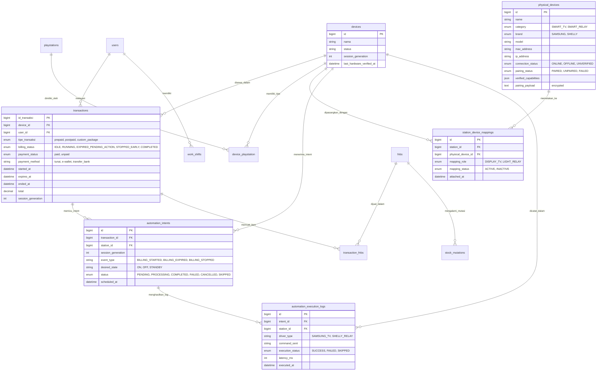

---

*Dokumen ini merupakan panduan alur pengguna dan referensi arsitektur resmi aplikasi Sugeng Rawuh berdasarkan source code aktual sistem_kasir_PS-main.*
