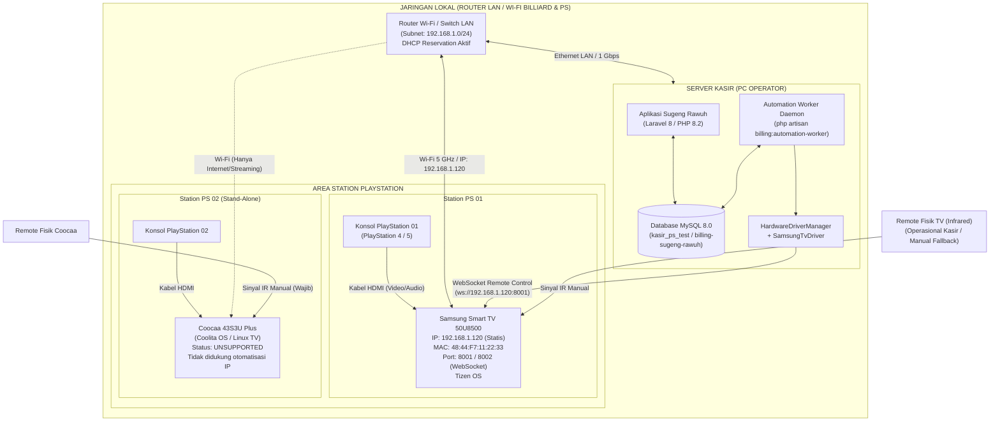
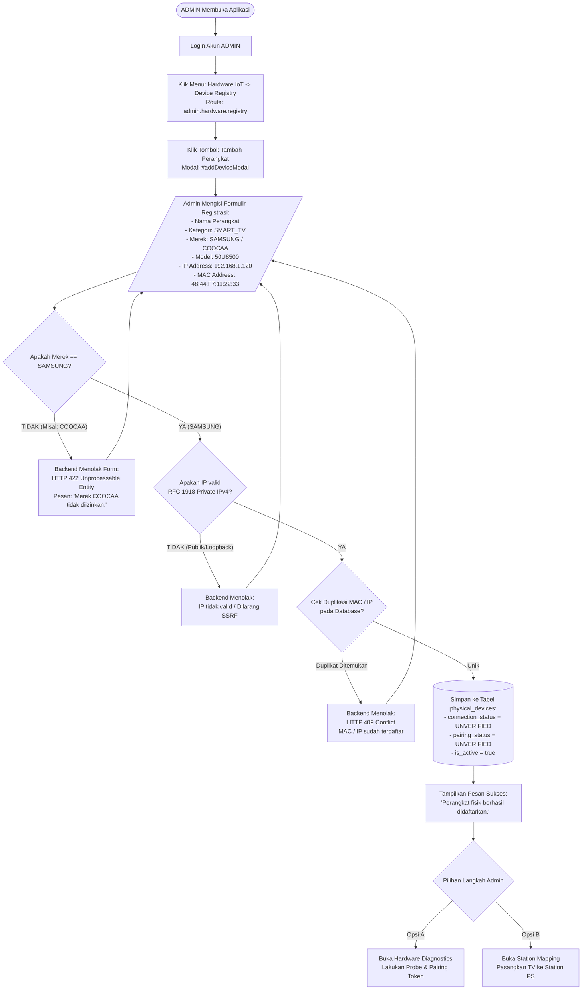
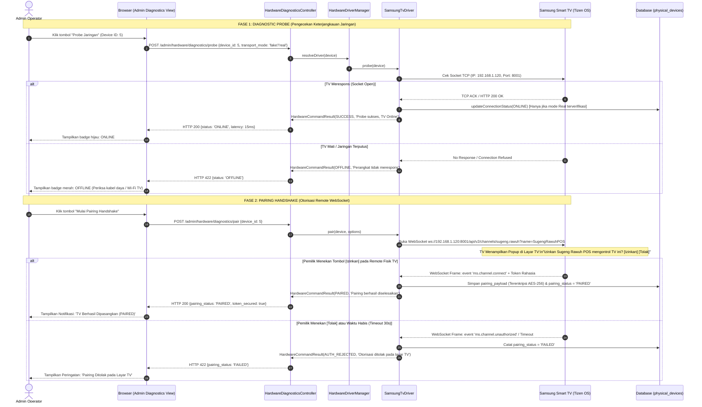
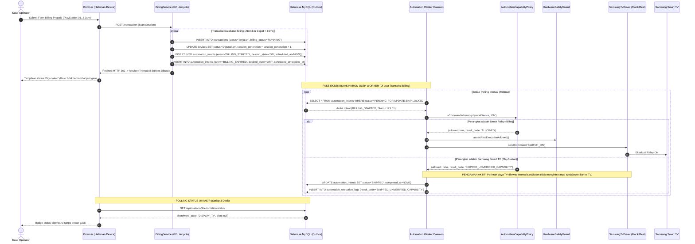
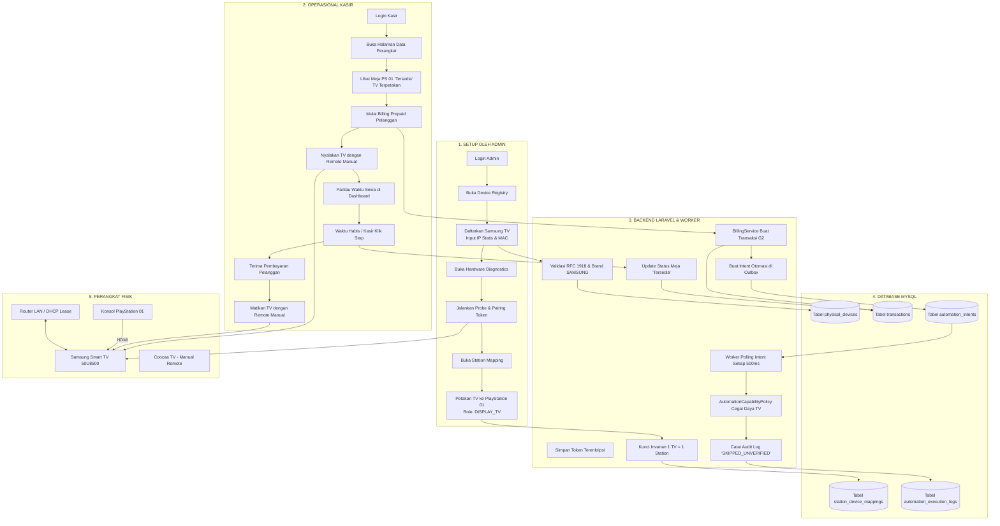

# PANDUAN MANAJEMEN SMART TV & ALUR PENGGUNAAN APLIKASI
## Sugeng Rawuh — Integrated Billing & POS Management System

**Versi Dokumen:** 1.0 (Pasca Gate G5-B / Persiapan Gate G4-B2)  
**Tanggal:** 6 November 2026  
**Status Sistem:** G5-B Software Mock E2E Complete (310 Automated Tests Passing)  
**Target Perangkat:** Samsung Smart TV 50U8500 (Tizen OS) & Coocaa 43S3U Plus (Coolita OS)  
**Bahasa:** Bahasa Indonesia  

---

## DAFTAR ISI

1. [Ringkasan Sistem & Status Implementasi](#1-ringkasan-sistem--status-implementasi)
2. [Daftar Pengguna & Hak Akses (RBAC)](#2-daftar-pengguna--hak-akses-rbac)
3. [Arsitektur Jaringan Smart TV (Diagram 1)](#3-arsitektur-jaringan-smart-tv-diagram-1)
4. [User Journey Admin: Mendaftarkan Smart TV (Diagram 2)](#4-user-journey-admin-mendaftarkan-smart-tv-diagram-2)
5. [Alur Discovery, Pairing & Koneksi TV (Diagram 3)](#5-alur-discovery-pairing--koneksi-tv-diagram-3)
6. [Alur Mapping TV ke Station PlayStation (Diagram 4)](#6-alur-mapping-tv-ke-station-playstation-diagram-4)
7. [Alur Kasir: Billing & Pengoperasian PlayStation (Diagram 5)](#7-alur-kasir-billing--pengoperasian-playstation-diagram-5)
8. [Alur Automation Engine & Hardware Control (Diagram 6)](#8-alur-automation-engine--hardware-control-diagram-6)
9. [State Diagram Perangkat & Matriks Kemampuan (Diagram 7)](#9-state-diagram-perangkat--matriks-kemampuan-diagram-7)
10. [Alur Penanganan Masalah / Troubleshooting (Diagram 8)](#10-alur-penanganan-masalah--troubleshooting-diagram-8)
11. [Alur Operasional Menyeluruh / End-to-End (Diagram 9)](#11-alur-operasional-menyeluruh--end-to-end-diagram-9)
12. [Panduan Penggunaan Langkah Demi Langkah](#12-panduan-penggunaan-langkah-demi-langkah)
    - [Panduan untuk Admin](#panduan-untuk-admin)
    - [Panduan untuk Kasir](#panduan-untuk-kasir)
    - [Panduan untuk Owner](#panduan-untuk-owner)
13. [Keterbatasan Teknis & Fitur yang Belum Terverifikasi](#13-keterbatasan-teknis--fitur-yang-belum-terverifikasi)
14. [Rangkuman Keseluruhan](#14-rangkuman-keseluruhan)

---

## 1. RINGKASAN SISTEM & STATUS IMPLEMENTASI

Sistem Kasir & Billing **Sugeng Rawuh** mengintegrasikan manajemen transaksi rental (PlayStation & Biliar), POS Food & Beverage (F&B), serta otomatisasi perangkat keras IoT.

Dalam arsitektur sistem:
- **Station Biliar** dikendalikan melalui Smart Relay (**Shelly 1PM Mini Gen3**) via protokol HTTP RPC untuk menyalakan/memadamkan lampu meja secara otomatis saat billing berjalan atau kedaluwarsa.
- **Station PlayStation** dihubungkan ke **Smart TV** sebagai layar tampilan (*Display TV*).

### Status Implementasi Aktual Berdasarkan Source Code Repository

| Komponen Hardware | Status Implementasi Software | Status Pengujian Lab / Fisik | Status Kebijakan Otomasi |
|---|---|---|---|
| **Samsung Smart TV 50U8500** | **IMPLEMENTED** (`SamsungTvDriver`, `MockSamsungTvDriver`, WebSocket port 8001/8002) | **MOCK/STUB ONLY** (Lulus 310 tes otomatis; pengujian pada TV fisik dijadwalkan pada Gate G4-B2) | **SKIPPED_UNVERIFIED_CAPABILITY** (Otomasi daya TV dinonaktifkan demi keselamatan perangkat; kasir menggunakan remote manual) |
| **Coocaa 43S3U Plus (Coolita OS)** | **UNSUPPORTED / NOT IMPLEMENTED** (Ditolak validasi backend HTTP 422) | **TIDAK TERSEDIA** (Tidak ada driver Coolita OS dalam kode) | **MANUAL ONLY** (Dioperasikan 100% mandiri via remote fisik di luar sistem aplikasi) |
| **Shelly 1PM Mini Gen3** | **IMPLEMENTED** (`ShellyRelayDriver`, `MockShellyRelayDriver`, HTTP RPC) | **MOCK/STUB ONLY** (Lulus 310 tes otomatis; uji beban fisik pada Gate G4-B2) | **ALLOWED** (Otomasi penuh: ON saat mulai billing, OFF seketika saat waktu habis) |

> [!IMPORTANT]
> **Prinsip Keselamatan Perangkat Keras:**  
> Smart Relay (Shelly) **DILARANG KERAS** dipasang pada kabel daya utama PlayStation atau Smart TV. Pemutusan arus listrik secara mendadak akan merusak komponen elektronik TV dan menyebabkan korupsi data *Solid State Drive* (SSD) konsol PlayStation. Smart Relay hanya diperuntukkan bagi sirkuit lampu meja biliar.

---

## 2. DAFTAR PENGGUNA & HAK AKSES (RBAC)

Aplikasi menerapkan kontrol akses berbasis peran (*Role-Based Access Control* / RBAC) yang ketat pada tingkat middleware (`CheckRole`):

| Peran (Role) | Akses Billing & Kasir | Akses Registry Hardware | Akses Station Mapping | Akses Diagnostik & Simulator | Akses Laporan Keuangan |
|---|---|---|---|---|---|
| **ADMIN** | Penuh (Buka/Tutup/Edit/Hapus) | Penuh (Tambah, Edit, Hapus) | Penuh (Petakan, Ganti, Lepas) | Penuh (Probe, Pair, Kirim Command) | Penuh |
| **KASIR** | Operasional (Buka, Stop, Extend, F&B) | **Dilarang** (HTTP 403) | **Read-Only Status** (Lihat status badge saja) | **Dilarang** (HTTP 403) | Terbatas (Shift & Kasir berjalan) |
| **OWNER** | Terbatas (Tidak bisa manipulasi transaksi) | **Read-Only** (Melihat daftar TV) | **Read-Only** (Melihat pemetaan) | **Dilarang** (HTTP 403) | Penuh (Laporan & Audit) |

---

## 3. ARSITEKTUR JARINGAN SMART TV (DIAGRAM 1)

Diagram berikut mengilustrasikan topologi jaringan lokal (*Local Area Network* / LAN) yang menghubungkan PC Kasir Sugeng Rawuh dengan Smart TV Samsung di area rental PlayStation.



### Penjelasan Teknis Arsitektur Jaringan:
1. **Komunikasi Berbasis IP Lokal:** PC Kasir berkomunikasi dengan Smart TV melalui protokol TCP/IP lokal pada jaringan privat (RFC 1918, subnet `192.168.1.0/24`). Tidak memerlukan koneksi internet publik untuk pengiriman perintah kontrol internal.
2. **Kebutuhan IP Address Statis:** Agar aplikasi selalu dapat menjangkau TV, router wajib dikonfigurasi dengan *DHCP Static Lease* (reservasi IP berdasarkan MAC Address TV), misalnya Samsung TV diatur tetap pada `192.168.1.120`.
3. **Fungsi MAC Address:** Digunakan sebagai identitas perangkat keras unik di database (`physical_devices.mac_address`) untuk mencegah duplikasi pendaftaran dan mendukung Wake-on-LAN (WOL) jika kompatibel.
4. **Batas Kendali Jaringan:** Mengetahui IP dan MAC Address **belum cukup** untuk mengendalikan TV. TV Samsung membutuhkan otorisasi jabat tangan (*handshake pairing token*) melalui port WebSocket 8001/8002.
5. **Posisi Coocaa Smart TV:** TV Coocaa 43S3U Plus (Coolita OS) tidak memiliki antarmuka API jaringan yang didukung sistem. TV ini tetap terhubung ke PlayStation via kabel HDMI, tetapi operasional menyalakan/mematikan dilakukan **secara manual dengan remote fisik**.

---

## 4. USER JOURNEY ADMIN: MENDAFTARKAN SMART TV (DIAGRAM 2)

Diagram alur keputusan berikut menunjukkan langkah Admin saat mendaftarkan Smart TV ke dalam sistem melalui menu **Device Registry**.



### Rincian Form Input Registrasi (`StorePhysicalDeviceRequest`):
- **Nama Perangkat (`name`):** Wajib, maksimal 100 karakter (Contoh: `Samsung TV PS 01`).
- **Kategori (`category`):** Wajib, nilai yang diterima hanya `SMART_TV` atau `SMART_RELAY`.
- **Merek (`brand`):** Wajib, nilai yang diterima hanya `SAMSUNG` (untuk Smart TV) atau `SHELLY` (untuk Smart Relay). Merek `COOCAA` ditolak otomatis.
- **Model (`model`):** Opsional, maksimal 50 karakter (Contoh: `50U8500`).
- **MAC Address (`mac_address`):** Wajib, 12 digit heksadesimal. Sistem otomatis menormalisasi format menjadi `AA:BB:CC:DD:EE:FF`.
- **IP Address (`ip_address`):** Wajib, IPv4 privat lokal (192.168.x.x, 10.x.x.x, atau 172.16-31.x.x). IP publik, loopback (127.0.0.1), dan multicast ditolak demi keamanan jaringan.

---

## 5. ALUR DISCOVERY, PAIRING & KONEKSI TV (DIAGRAM 3)

Diagram urutan (*sequence diagram*) ini menjelaskan interaksi teknis saat Admin menguji koneksi (*Probe*) dan melakukan *Pairing Handshake* dengan Samsung Smart TV.



### Catatan Keamanan Kredensial:
- Token pairing yang diberikan TV disimpan dalam kolom `physical_devices.pairing_payload` yang dienkripsi secara otomatis oleh Laravel (`casts => 'encrypted'`).
- Kolom ini dimasukkan ke dalam daftar `$hidden` pada model, sehingga token otorisasi **tidak pernah bocor** ke antarmuka JSON atau browser kasir.

---

## 6. ALUR MAPPING TV KE STATION PLAYSTATION (DIAGRAM 4)

Diagram berikut menjelaskan bagaimana Admin menghubungkan Smart TV yang sudah terdaftar dengan unit PlayStation tertentu di menu **Station Mapping**.

```mermaid
flowchart TD
    START([ADMIN Membuka Menu Station Mapping]) --> ROUTE[Route: admin.hardware.mappings\nView: admin.hardware.mappings]
    ROUTE --> SELECT_STATION[Pilih Station Rental:\nContoh: 'PlayStation 01' / ID: 3]
    
    SELECT_STATION --> CHECK_BILLING{Apakah Station sedang\nberstatus 'Digunakan' / Billing Aktif?}
    
    CHECK_BILLING -- "YA (Sedang Digunakan)" --> REJECT_BILLING[Kunci Keamanan Aktif:\nHTTP 409 Conflict\n'Stasiun sedang aktif transaksi. Mapping dilarang diubah!']
    REJECT_BILLING --> END_FAIL([Batal / Tunggu Sesi Selesai])
    
    CHECK_BILLING -- "TIDAK (Tersedia)" --> OPEN_MODAL[Buka Modal Pasangkan Hardware:\nModal: #attachHardwareModal]
    
    OPEN_MODAL --> CHOOSE_DEVICE[Pilih Smart TV dari Dropdown:\nContoh: 'Samsung TV PS 01' / ID: 5\nMapping Role: DISPLAY_TV]
    
    CHOOSE_DEVICE --> VALIDATE_COMPAT{Validasi Kompatibilitas:\nStation PS harus dipetakan ke SMART_TV\ndan Role DISPLAY_TV?}
    
    VALIDATE_COMPAT -- "Salah (Misal dipasangkan ke Relay Biliar)" --> REJECT_COMPAT[Backend Menolak:\nHTTP 422 Unprocessable Entity\n'Hardware tidak kompatibel dengan jenis station.']
    REJECT_COMPAT --> OPEN_MODAL
    
    VALIDATE_COMPAT -- "Sesuai" --> CHECK_SINGLE_MAP{Cek Invarian Tunggal:\nApakah TV sudah dipetakan\nke station lain?}
    
    CHECK_SINGLE_MAP -- "Sudah Dipetakan ke PS 02" --> REJECT_MAPPED[Backend Menolak:\nHTTP 409 Conflict\n'Hardware ini sudah aktif di PlayStation 02!']
    REJECT_MAPPED --> OPEN_MODAL
    
    CHECK_SINGLE_MAP -- "Belum Dipetakan" --> DB_TRANS[Mulai DB Transaction:\n1. Lock baris Station (Pessimistic Lock)\n2. Lock baris Physical Device\n3. Simpan ke station_device_mappings\n4. Catat attached_by_user_id & attached_at]
    
    DB_TRANS --> COMMIT[(Commit Database Transaction)]
    COMMIT --> SUCCESS[Tampilkan Hubungan Aktif:\nPlayStation 01 <---> Samsung TV PS 01\nRole: DISPLAY_TV | Status: ACTIVE]
    SUCCESS --> END_SUCCESS([Selesai])
```

### Mengapa Pemetaan Ini Sangat Penting?
1. **Pemisahan Identitas Perangkat:** `devices.id` adalah nomor meja/station rental kasir (PlayStation 01). Sedangkan `physical_devices.id` adalah identitas TV fisik (Samsung 50U8500 dengan MAC `48:44:F7:...`).
2. **Fleksibilitas Penggantian TV (*Hot Swap*):** Jika TV di PlayStation 01 rusak, Admin tidak perlu mengubah data transaksi atau riwayat PlayStation. Cukup lakukan fitur **Ganti Hardware** (*replace hardware*) di menu pemetaan, sehingga riwayat audit lama tetap tersimpan.
3. **Pencegahan Sinyal Salah Alamat:** Sistem mengunci invarian 1-ke-1 aktif sehingga tidak mungkin 1 TV diperintahkan menyala oleh dua kasir di station yang berbeda.

---

## 7. ALUR KASIR: BILLING & PENGOPERASIAN PLAYSTATION (DIAGRAM 5)

Diagram berikut menjelaskan pengalaman pengguna (*user journey*) kasir saat melayani pelanggan rental PlayStation, mulai dari pemilihan stasiun hingga penanganan TV secara manual.

```mermaid
flowchart TD
    START([KASIR Membuka Halaman Data Perangkat]) --> VIEW_DEVICE[Route: device.index\nKasir Melihat Daftar Kartu Station]
    
    VIEW_DEVICE --> CARD_INFO[Kartu PlayStation 01:\n- Status Meja: Tersedia\n- Info TV: Samsung TV PS 01 (Online)\n- Badge Otomasi: DISPLAY_TV]
    
    CARD_INFO --> BTN_START[Klik Tombol: 'Mulai Billing']
    BTN_START --> FORM_TX[/Form Transaksi:\n- Nama Pelanggan: 'Budi'\n- Jenis Billing: Prepaid / Lost Time\n- Pilihan Paket / Jam Main: 2 Jam\n- Tambahan F&B (Opsional)/]
    
    FORM_TX --> SUBMIT[Klik 'Simpan Transaksi']
    SUBMIT --> BILLING_SVC[BillingService::startSession\n1. Kunci Baris Device (LockForUpdate)\n2. Buat Transaksi Billing G2\n3. Naikkan session_generation (+1)\n4. Simpan Outbox Intent ke Database]
    
    BILLING_SVC --> OUTBOX[(Tabel automation_intents:\n- Event: BILLING_STARTED\n- Desired State: ON\n- Station: PlayStation 01)]
    
    OUTBOX --> WORKER_TICK[Automation Worker Membaca Intent]
    WORKER_TICK --> POLICY_CHECK{AutomationCapabilityPolicy:\nCek Izin Kontrol Daya TV}
    
    POLICY_CHECK -- "Samsung Smart TV" --> POLICY_SKIP[Hasil: SKIPPED_UNVERIFIED_CAPABILITY\nOtomasi Power Dinonaktifkan demi Keamanan]
    
    POLICY_SKIP --> LOG_AUDIT[(automation_execution_logs:\nStatus: SKIPPED\nCatatan: Manual Control Required)]
    
    LOG_AUDIT --> CARD_RUNNING[Kartu Meja Berubah:\n- Status: Digunakan\n- Timer Hitung Mundur Berjalan\n- Badge Hardware: DISPLAY_TV]
    
    CARD_RUNNING --> MANUAL_ACTION[Tindakan Fisik Kasir:\nNyalakan Samsung TV menggunakan Remote TV Fisik\ndan Pilih Input HDMI PlayStation 01]
    
    MANUAL_ACTION --> PLAYING[Pelanggan Bermain Game]
    
    PLAYING --> SESSION_END{Kondisi Selesai Sesi}
    
    SESSION_END -->|"Waktu Habis (Prepaid)"| EXPIRED[Waktu Habis:\nTimer 00:00:00\nSesi Masuk Status EXPIRED]
    SESSION_END -->|"Stop Lebih Awal"| STOP_EARLY[Kasir Menekan Tombol Stop Meja]
    SESSION_END -->|"Perpanjang Waktu"| EXTEND[Kasir Menambah Jam Main]
    
    EXTEND --> PLAYING
    
    STOP_EARLY --> FINAL_TX[Finalisasi Biaya & Pembayaran di Kasir]
    EXPIRED --> FINAL_TX
    
    FINAL_TX --> MANUAL_OFF[Tindakan Fisik Kasir:\nMatikan TV atau pindahkan input dengan Remote Fisik]
    MANUAL_OFF --> RELEASE_DEVICE[Status Meja Kembali 'Tersedia']
```

---

## 8. ALUR AUTOMATION ENGINE & HARDWARE CONTROL (DIAGRAM 6)

Diagram urutan (*sequence diagram*) ini menjelaskan pemisahan tegas antara transaksi keuangan di billing dengan eksekusi perintah hardware di latar belakang.



### Mengapa Kegagalan Kontrol TV Tidak Membatalkan Transaksi Billing?
Dalam industri rental, kepastian pencatatan transaksi keuangan dan waktu sewa pelanggan adalah prioritas utama. Apabila Smart TV tiba-tiba dicabut dari stopkontak atau koneksi Wi-Fi TV terputus, **transaksi billing kasir tidak boleh terganggu**. Pelanggan tetap dapat bermain, dan kasir tetap dapat menghitung tagihan dengan akurat.

---

## 9. STATE DIAGRAM PERANGKAT & MATRIKS KEMAMPUAN (DIAGRAM 7)

### A. State Diagram Domain Perangkat Keras
Perlu dipahami bahwa sistem memisahkan status ke dalam **tiga lapisan domain independen**:

```mermaid
flowchart TD
    subgraph DOMAIN_KONEKSI["1. Status Koneksi Jaringan (physical_devices.connection_status)"]
        CONN_UNVERIFIED["UNVERIFIED\n(Baru didaftarkan)"] -->|Uji Probe Berhasil| CONN_ONLINE["ONLINE\n(Socket Terbuka & Merespons)"]
        CONN_UNVERIFIED -->|Uji Probe Gagal| CONN_OFFLINE["OFFLINE\n(Timeout / Tidak Terjangkau)"]
        CONN_ONLINE -->|Koneksi Putus| CONN_OFFLINE
        CONN_OFFLINE -->|Koneksi Pulih| CONN_ONLINE
    end

    subgraph DOMAIN_PAIRING["2. Status Otorisasi Pairing (physical_devices.pairing_status)"]
        PAIR_UNVERIFIED["UNVERIFIED\n(Belum diverifikasi)"] -->|Kirim Request Pairing| PAIR_PENDING["PENDING\n(Menunggu popup di layar)"]
        PAIR_PENDING -->|Diizinkan di Layar TV| PAIR_PAIRED["PAIRED\n(Token tersimpan aman)"]
        PAIR_PENDING -->|Ditolak / Timeout| PAIR_FAILED["FAILED\n(Otorisasi ditolak)"]
        PAIR_FAILED -->|Pairing Ulang Berhasil| PAIR_PAIRED
    end

    subgraph DOMAIN_INTENT["3. Status Antrean Otomasi (automation_intents.status)"]
        INT_PENDING["PENDING\n(Menunggu jadwal)"] -->|Diklaim Worker| INT_PROCESSING["PROCESSING\n(Lease 60 detik)"]
        INT_PROCESSING -->|Lolos Policy & Eksekusi| INT_COMPLETED["COMPLETED\n(Berhasil)"]
        INT_PROCESSING -->|Dicegat Policy TV| INT_SKIPPED["SKIPPED\n(Unverified Capability)"]
        INT_PROCESSING -->|Network Gagal| INT_RETRY["RETRY_PENDING\n(Maks 4 Percobaan)"]
        INT_RETRY -->|Gagal Total| INT_FAILED["FAILED\n(Alert di Layar Kasir)"]
        INT_PENDING -->|Sesi Diperpanjang/Batal| INT_CANCELLED["CANCELLED\n(Dibatalkan Billing)"]
        INT_PROCESSING -->|Generasi Meja Berubah| INT_STALE["STALE\n(Kadaluwarsa)"]
    end
```



---

### B. Matriks Kemampuan & Dukungan Perintah Smart TV

| Merek & Model Perangkat | Perintah (*Command*) | Status Kode Driver | Verifikasi Fisik (*Lab*) | Kebijakan Otomasi (*Worker*) | Penjelasan Teknis |
|---|---|---|---|---|---|
| **Samsung 50U8500** | `GET_STATUS` | **IMPLEMENTED** | Pending G4-B2 | **Diagnostik Terbatas** | Membaca info REST API port 8001 (`/api/v2/`). Mengembalikan info perangkat dan status daya jika online. |
| **Samsung 50U8500** | `MUTE` / `UNMUTE` | **IMPLEMENTED** | Pending G4-B2 | **Tidak Aman untuk Retry** | Protokol Samsung menggunakan satu kode remote: `KEY_MUTE` yang bersifat **toggle** (bolak-balik). Mengulang perintah ini secara otomatis dapat mematikan suara TV yang seharusnya menyala. |
| **Samsung 50U8500** | `STANDBY` | **IMPLEMENTED** | Pending G4-B2 | **DISABLED OTOMATIS** | Mengirim frame `KEY_POWER`. Karena `KEY_POWER` adalah tombol toggle, jika TV sudah dalam posisi mati lalu dikirimi perintah ini, TV justru akan menyala kembali. |
| **Samsung 50U8500** | `POWER_ON` | **CANDIDATE** | Belum Diverifikasi | **DISABLED OTOMATIS** | Samsung TV yang sedang *standby* mematikan antarmuka WebSocket. TV tidak dapat dinyalakan via WebSocket murni tanpa paket khusus *Wake-on-LAN* (WOL) atau sinyal HDMI-CEC dari konsol PlayStation. |
| **Coocaa 43S3U Plus** | Semua Perintah | **NOT IMPLEMENTED** | Tidak Didukung | **REJECTED (Tolak)** | Pendaftaran merek COOCAA ditolak pada form dan backend (HTTP 422). Seluruh operasional TV Coocaa menggunakan remote fisik manual. |

---

## 10. ALUR PENANGANAN MASALAH / TROUBLESHOOTING (DIAGRAM 8)

Diagram pemecahan masalah berikut merinci alur investigasi ketika terjadi kendala operasional pada Smart TV.

```mermaid
flowchart TD
    ISSUE([Kendala Terdeteksi pada Smart TV]) --> IDENTIFY{Identifikasi Gejala}

    %% Cabang 1: TV Offline
    IDENTIFY -->|"TV Berstatus OFFLINE\npada Dashboard"| PROB_OFFLINE[Penyebab:\n1. Kabel daya TV lepas / saklar off\n2. Wi-Fi TV terputus dari router\n3. IP Address TV berubah]
    PROB_OFFLINE --> FIX_OFFLINE[Solusi Admin:\n1. Pastikan lampu indikator TV menyala\n2. Cek menu Wi-Fi di TV apakah terhubung ke LAN\n3. Kunci IP di router dengan DHCP Reservation\n4. Jalankan 'Probe Jaringan' di Diagnostics]

    %% Cabang 2: Pairing Gagal
    IDENTIFY -->|"Pairing Status FAILED\natau Muncul Peringatan"| PROB_PAIR[Penyebab:\n1. Operator tidak menekan [Izinkan] di TV\n2. Waktu konfirmasi (30s) habis\n3. Token otorisasi kadaluwarsa]
    PROB_PAIR --> FIX_PAIR[Solusi Admin:\n1. Nyalakan layar TV\n2. Buka menu Diagnostics -> Pilih Pair\n3. Segera tekan [Izinkan] pada remote TV\n4. Sistem akan otomatis menyimpan token baru]

    %% Cabang 3: TV Coocaa Ditolak
    IDENTIFY -->|"Gagal Mendaftarkan\nTV Coocaa (Error 422)"| PROB_COOCAA[Penyebab:\nMerek COOCAA ditolak sistem keamanan\nkarena tidak memiliki driver API terverifikasi]
    PROB_COOCAA --> FIX_COOCAA[Solusi Operasional:\n1. Jangan daftarkan TV Coocaa di Device Registry\n2. Biarkan station PS berjalan tanpa mapping TV\n3. Kasir menggunakan remote fisik bawaan TV\n4. Billing rental PS tetap berjalan normal 100%]

    %% Cabang 4: TV Tidak Mau Mati Otomatis
    IDENTIFY -->|"TV Tidak Mati Otomatis\nsaat Waktu Rental Habis"| PROB_POLICY[Penyebab:\nKebijakan Keselamatan G5-B:\nOtomasi power TV dinonaktifkan\n(SKIPPED_UNVERIFIED_CAPABILITY)]
    PROB_POLICY --> FIX_POLICY[Solusi Operasional:\nPerilaku ini NORMAL dan SESUAI DESAIN.\nKasir mematikan TV menggunakan remote manual\nuntuk melindungi komponen TV & PS]

    %% Cabang 5: Station Mapping Salah
    IDENTIFY -->|"TV Tertukar antar Meja\n(Contoh: PS 01 mengontrol PS 02)"| PROB_MAP[Penyebab:\nAdmin salah memilih perangkat fisik\nsaat melakukan Station Mapping]
    PROB_MAP --> FIX_MAP[Solusi Admin:\n1. Buka menu Station Mapping\n2. Cari station yang bersangkutan\n3. Klik 'Ganti Hardware'\n4. Pilih TV dengan IP/MAC yang sesuai]
```

### Panduan Tindakan Cepat (Troubleshooting Table):

| Gejala pada Layar | Pemeriksaan Kasir | Tindakan Lanjutan Admin | Batasan Hak Akses |
|---|---|---|---|
| Badge TV menampilkan `OFFLINE` | Periksa apakah TV dicolokkan ke listrik dan layar menyala. Lanjutkan billing seperti biasa. | Masuk ke menu Diagnostics, klik **Probe Jaringan**. Periksa router apakah IP TV berubah. | Kasir dilarang mengubah konfigurasi IP atau menjalankan diagnostik. |
| Kasir melihat alert `COMMAND_FAILED` | Klik tombol **Coba Ulang** (*Retry*) pada kartu meja jika tersedia. | Periksa log di menu `/admin/hardware/automation/logs` untuk melihat rincian kegagalan. | Kasir tidak dapat melihat IP atau token otorisasi. |
| Muncul notifikasi `Merek COOCAA ditolak (422)` | Informasikan ke Admin bahwa TV Coocaa tidak perlu didaftarkan di sistem. | Gunakan remote fisik TV Coocaa. Jangan mencoba mengubah kode untuk membypass validasi. | Kebijakan sistem: TV Coocaa dioperasikan manual. |

---

## 11. ALUR OPERASIONAL MENYELURUH / END-TO-END (DIAGRAM 9)

Diagram besar ini merangkum seluruh perjalanan operasional lintas aktor: Admin, Kasir, Backend Laravel, Database, dan Perangkat Fisik.



---

## 12. PANDUAN PENGGUNAAN LANGKAH DEMI LANGKAH

### PANDUAN UNTUK ADMIN

#### 1. Cara Menghubungkan TV Samsung ke Jaringan Toko
1. Nyalakan TV Samsung menggunakan remote fisik.
2. Masuk ke menu **Pengaturan TV** (*Settings*) -> **Umum** (*General*) -> **Jaringan** (*Network*).
3. Pilih **Buka Pengaturan Jaringan** -> Pilih Wi-Fi kasir (rekomendasikan frekuensi 5 GHz) atau tancapkan kabel LAN.
4. Masuk ke **Status Jaringan** -> **Pengaturan IP** (*IP Settings*).
5. Catat **Alamat IP** (misal: `192.168.1.120`) dan **Alamat MAC** TV (misal: `48:44:F7:11:22:33`).
6. *Sangat disarankan:* Buka router toko, masuk ke menu *DHCP Static Leases*, dan kunci agar TV selalu mendapatkan IP tersebut.

#### 2. Cara Mendaftarkan TV Samsung di Aplikasi
1. Buka browser dan login menggunakan akun Admin:
   - Email: `admin@gmail.com`
   - Password: `password`
2. Di sidebar sebelah kiri, cari kelompok menu **Hardware IoT**, lalu klik **Device Registry** (URL: `/admin/hardware/registry`).
3. Klik tombol **Tambah Perangkat** di pojok kanan atas tabel.
4. Isi formulir modal:
   - **Nama Perangkat:** Beri nama yang jelas (Contoh: `Samsung TV PS 01`).
   - **Kategori:** Pilih `SMART_TV`.
   - **Merek:** Pilih `SAMSUNG` (Pilihan merek Coocaa tidak tersedia/dilarang).
   - **Model:** Isi tipe TV (Contoh: `50U8500`).
   - **MAC Address:** Masukkan MAC yang dicatat (Contoh: `48:44:F7:11:22:33`).
   - **IP Address:** Masukkan IP TV (Contoh: `192.168.1.120`).
5. Klik **Simpan Perangkat**. Data akan tersimpan dengan status koneksi `UNVERIFIED`.

#### 3. Cara Melakukan Pairing Token TV
1. Pastikan TV Samsung dalam kondisi **menyala** dan berada pada layar beranda/HDMI.
2. Di sidebar, klik **Hardware Diagnostics** (URL: `/admin/hardware/diagnostics`).
3. Cari nama TV yang baru didaftarkan, lalu klik tombol **Probe Jaringan** untuk memastikan TV terdeteksi online.
4. Klik tombol **Pairing Handshake**.
5. **Perhatikan Layar TV:** Layar TV akan memunculkan jendela sembulan (*popup*): *"Apakah Anda ingin mengizinkan Sugeng Rawuh POS mengontrol TV ini?"*
6. Gunakan remote fisik TV, arahkan ke tombol **[Izinkan]** (*Allow*) dan tekan tombol **Enter/OK**.
7. Aplikasi kasir akan menampilkan notifikasi hijau: *"Pairing Berhasil Diselesaikan"*, dan status pairing berubah menjadi `PAIRED`.

#### 4. Cara Memetakan TV ke Station PlayStation
1. Di sidebar, klik **Station Mapping** (URL: `/admin/hardware/mappings`).
2. Cari baris stasiun rental yang diinginkan (Contoh: `PlayStation 01`).
3. Klik tombol **Pasangkan Hardware** (ikon rantai).
4. Pilih TV dari daftar dropdown: `Samsung TV PS 01`.
5. Pastikan Peran Mapping terpilih: `DISPLAY_TV`.
6. Klik **Simpan Pemetaan**. TV sekarang resmi terhubung secara digital ke PlayStation 01.

---

### PANDUAN UNTUK KASIR

#### 1. Cara Melayani Pelanggan Rental PlayStation
1. Login dengan akun Kasir:
   - Email: `operator1@gmail.com`
   - Password: `password`
2. Masuk ke halaman **Data Perangkat** (URL: `/device`).
3. Cari kartu station PlayStation (Contoh: `PlayStation 01`). Perhatikan badge di bawah nama meja:
   - Jika tertulis `DISPLAY_TV` berwarna abu-abu/biru muda, artinya TV sudah terdaftar di sistem.
4. Klik tombol **Mulai Billing**.
5. Isi data pelanggan:
   - **Nama Pelanggan:** Nama penyewa (misal: "Mas Doni").
   - **Pilihan Paket / Durasi:** Pilih durasi (misal: 2 Jam) atau pilih *Lost Time* (tanpa batas waktu).
   - Tambahkan pesanan makanan/minuman jika pelanggan memesan F&B.
6. Klik **Simpan Transaksi**.
7. Status meja akan berubah menjadi **Digunakan** dan jam hitung mundur mulai berjalan.
8. **Tindakan Kasir:** Ambil remote fisik TV Samsung, nyalakan layar TV, dan pastikan input video berada pada HDMI PlayStation 01. Persilakan pelanggan bermain.

#### 2. Saat Waktu Sewa Habis / Pelanggan Selesai
1. Ketika waktu habis (*Prepaid Expired*), timer di layar kasir akan mencapai `00:00:00`.
2. Kasir memproses pembayaran tagihan di menu Transaksi.
3. Setelah pembayaran selesai, status meja otomatis kembali menjadi **Tersedia**.
4. **Tindakan Kasir:** Matikan layar TV menggunakan remote fisik atau alihkan ke saluran standby toko.

#### 3. Bagaimana Jika TV Merek Coocaa?
- TV Coocaa **tidak terdaftar di sistem komputer** (ini normal dan sesuai aturan sistem).
- Kasir menjalankan transaksi billing PlayStation seperti biasa di komputer.
- Nyalakan dan matikan TV Coocaa sepenuhnya menggunakan remote fisik bawaan TV Coocaa.

---

### PANDUAN UNTUK OWNER

1. **Hak Akses:** Owner memiliki akses peninjauan (*read-only*) untuk mengawasi operasional tanpa risiko mengubah pengaturan teknis secara tidak sengaja.
2. **Melihat Daftar TV:** Buka menu **Hardware IoT** -> **Device Registry**. Owner dapat melihat seluruh TV yang dimiliki toko beserta status koneksinya.
3. **Melihat Pemetaan:** Buka menu **Station Mapping** untuk melihat TV mana saja yang sedang dipasang di PlayStation 01, 02, dan seterusnya.
4. **Laporan & Pendapatan:** Buka menu **Laporan Penjualan** dan **Laporan Keuangan** untuk memantau omzet rental PlayStation dan F&B harian/bulanan.
5. *Catatan:* Menu Diagnostik dan Simulator disembunyikan dari akun Owner karena menu tersebut khusus untuk penanganan teknis oleh Admin.

---

## 13. KETERBATASAN TEKNIS & FITUR YANG BELUM TERVERIFIKASI

Sebagai bentuk transparansi sistem dan kepatuhan audit:

1. **Tidak Ada Fitur Auto-Discovery TV di Jaringan:**  
   Sistem tidak melakukan pemindaian otomatis (*SSDP / mDNS background scan*) untuk mendeteksi TV baru. Seluruh pendaftaran TV harus diinput secara manual oleh Admin melalui form registrasi (Nama, IP, MAC).
2. **Keterbatasan Wake-on-LAN (WOL) Samsung:**  
   Menyalakan Samsung Smart TV dari kondisi mati total (*Deep Standby*) via koneksi Wi-Fi seringkali tidak didukung oleh arsitektur Tizen OS jika kartu jaringan TV tidur (*sleep state*). Fitur `POWER_ON` otomatis dinonaktifkan di software sampai pengujian fisik di Gate G4-B2 membuktikan keandalannya.
3. **Status Online vs Izin Kontrol:**  
   Status `ONLINE` pada menu registrasi hanya menandakan bahwa alamat IP TV merespons jabat tangan soket jaringan. Status ini **bukan jaminan** bahwa TV dapat menerima perintah jika proses pairing belum disetujui di layar TV.
4. **Merek Coocaa Tidak Memiliki Driver Remote:**  
   TV Coocaa 43S3U Plus menggunakan sistem operasi Coolita OS yang tidak menyediakan dokumentasi API remote kontrol lokal publik. Upaya mendaftarkan merek COOCAA akan ditolak dengan error 422 oleh sistem validasi.
5. **Larangan Smart Relay untuk Mematikan TV:**  
   Sistem secara tegas melarang penggunaan smart relay pemutus arus listrik (seperti Shelly) untuk mematikan TV atau PlayStation, karena berisiko merusak unit secara fisik.

---

## 14. RANGKUMAN KESELURUHAN

Sistem Manajemen Smart TV di Sugeng Rawuh dirancang dengan memprioritaskan **keselamatan hardware** dan **kelancaran transaksi bisnis kasir**:

1. **Pemisahan Peran:** Smart Relay mengotomasi lampu meja biliar, sedangkan Smart TV diintegrasikan secara logis untuk station PlayStation.
2. **Stabilitas Kasir:** Gangguan jaringan pada TV tidak akan pernah menggagalkan atau membatalkan transaksi sewa pelanggan.
3. **Keamanan Data:** Token pairing dan kredensial jaringan dienkripsi penuh di database dan tidak dapat dilihat oleh kasir.
4. **Kesiapan Tahapan:** Seluruh fondasi software dan simulasi mock telah lulus 100% (310 tes otomatis). Pengujian sambungan fisik ke unit TV nyata akan dilaksanakan secara bertahap pada **Gate G4-B2 (Physical Bench Testing)**.
