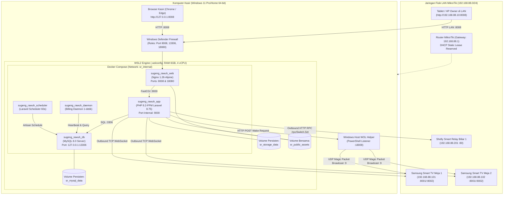
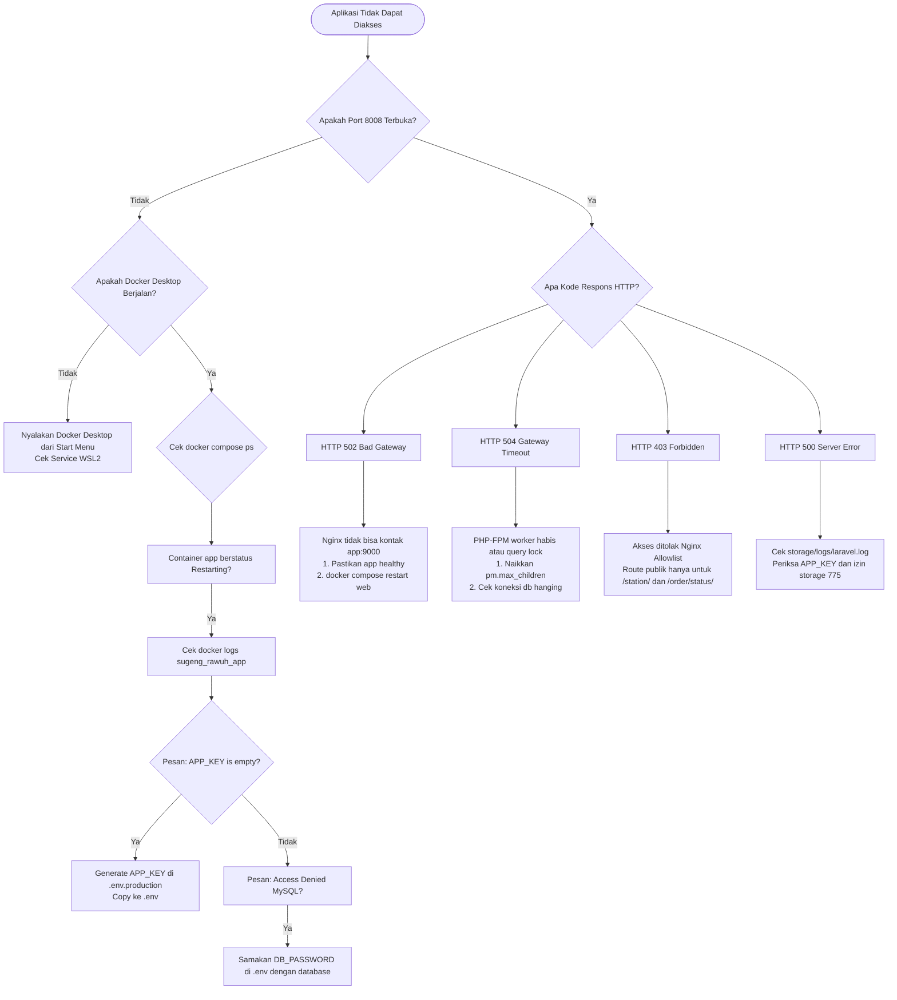

# Panduan Teknis Komprehensif: Instalasi, Konfigurasi, dan Pemeliharaan Sugeng Rawuh Billing & POS
## Windows 11 64-bit Menggunakan Laravel, WSL2, Docker Desktop, dan LAN MikroTik

**Target Sistem:** Sugeng Rawuh — Integrated Billing, POS & IoT System  
**Dokumen Referensi Deployment:** `docs/deployment/PANDUAN-INSTALASI-SUGENG-RAWUH-WINDOWS11-WSL2-DOCKER.md`  
**Target Komputer:** PC Kasir Windows 11 (Intel Core i5 Gen-10, Motherboard MSI H510M, 16 GB RAM, 512 GB SSD)  
**Versi Aplikasi:** v2.0.0 (Production Release)  
**Metode Penerapan:** Metode 1 (Git Clone + WSL2 Linux Kernel + Docker Compose Engine + Laravel 8.75)  
**Status Operasional:** 100% Offline-Ready (Mandiri tanpa internet pasca-instalasi)

---

## DAFTAR ISI

- [BAB 1 — Pengenalan Sistem dan Arsitektur](#bab-1--pengenalan-sistem-dan-arsitektur)
- [BAB 2 — Persiapan Komputer Kasir](#bab-2--persiapan-komputer-kasir)
- [BAB 3 — Instalasi Software Prasyarat](#bab-3--instalasi-software-prasyarat)
- [BAB 4 — Mengambil Source Code GitHub](#bab-4--mengambil-source-code-github)
- [BAB 5 — Konfigurasi Laravel dan Environment](#bab-5--konfigurasi-laravel-dan-environment)
- [BAB 6 — Konfigurasi Docker dan Database](#bab-6--konfigurasi-docker-dan-database)
- [BAB 7 — Menjalankan dan Mengoperasikan Aplikasi](#bab-7--menjalankan-dan-mengoperasikan-aplikasi)
- [BAB 8 — Konfigurasi Jaringan LAN, Perangkat Hardware, dan Cloudflare Tunnel](#bab-8--konfigurasi-jaringan-lan-perangkat-hardware-dan-cloudflare-tunnel)
- [BAB 9 — Testing dan Validasi Komprehensif](#bab-9--testing-dan-validasi-komprehensif)
- [BAB 10 — Troubleshooting Terstruktur dan Penanganan Masalah](#bab-10--troubleshooting-terstruktur-dan-penanganan-masalah)
- [BAB 11 — Backup, Restore, Upgrade, dan Disaster Recovery](#bab-11--backup-restore-upgrade-dan-disaster-recovery)
- [BAB 12 — Checklist Akhir dan Berita Acara Serah Terima](#bab-12--checklist-akhir-dan-berita-acara-serah-terima)

---

## BAB 1 — Pengenalan Sistem dan Arsitektur

### 1.1. Gambaran Umum Sistem
**Sugeng Rawuh Billing & POS** adalah platform manajemen kasir rental PlayStation (PS3, PS4, PS5) dan meja biliar yang terintegrasi dengan penjualan makanan/minuman (F&B) serta otomasi perangkat keras berbasis IoT (Samsung Smart TV WebSocket/WOL dan Shelly Smart Relay).

Sistem dirancang dengan arsitektur **Local-First**: seluruh komputasi, database, worker sub-detik, dan aset antarmuka dijalankan secara mandiri di komputer kasir lokal Windows 11 menggunakan container Docker melalui WSL2. Sistem tidak bergantung pada cloud VPS untuk operasional transaksi kasir harian.

### 1.2. Interaksi Antarkomponen (Multi-Layer Architecture)
Sistem beroperasi dalam 4 lapisan komputasi:
1. **Windows 11 Host OS:** Menjalankan antarmuka kasir (browser), Docker Desktop, Windows Defender Firewall, dan *Windows Host Wake-on-LAN (WOL) Helper* pada port host `18009`.
2. **WSL2 Virtual Machine (Linux Kernel):** Menyediakan subsistem virtualisasi ringan untuk menjalankan container Linux (`linux/amd64`) dengan alokasi resource terbatas.
3. **Docker Compose Stack (5 Container):**
   - **`sugeng_rawuh_web` (Nginx 1.26-Alpine):** Web server reverse proxy, menangani aset statis (`sr_public_assets`) dan meneruskan request dinamis ke PHP-FPM. Port publik lokal: `8008` (Kasir/LAN) dan `18080` (Origin Tunnel Khusus FnB Pelanggan).
   - **`sugeng_rawuh_app` (PHP 8.2-FPM Bookworm):** Core framework Laravel 8.75, menangani logika bisnis, migrasi skema, dan API.
   - **`sugeng_rawuh_db` (MySQL 8.0 Community):** RDBMS persisten, data disimpan pada Docker named volume `sr_mysql_data`. Port host internal: `127.0.0.1:13306`.
   - **`sugeng_rawuh_daemon` (PHP 8.2 CLI Worker):** Daemon billing presisi sub-menit (`php artisan billing:daemon --interval=1000 --lease=60`) yang memantau hitung mundur durasi sewa setiap detik.
   - **`sugeng_rawuh_scheduler` (PHP 8.2 CLI Loop):** Eksekutor otomatisasi Laravel (`php artisan schedule:run`) setiap 60 detik untuk pembersihan transaksi kedaluwarsa dan pemeliharaan stok.
4. **Jaringan Fisik LAN (MikroTik Subnet 192.168.88.0/24):** Menghubungkan PC kasir dengan Samsung Smart TV (port 8001/8002) dan Shelly Smart Relay (port 80).

### 1.3. Diagram Arsitektur Sistem (Mermaid)



---

## BAB 2 — Persiapan Komputer Kasir

### 2.1. Analisis Kelayakan Perangkat Keras Target

| Komponen | Spesifikasi Terpasang | Analisis Kelayakan & Kebutuhan Beban Kerja | Status |
|---|---|---|:---:|
| **Processor** | Intel Core i5 Generasi ke-10 (6 Core, 12 Thread) | Sangat mencukupi. Komputasi PHP-FPM, MySQL, dan daemon 1 detik hanya membebani < 3% kapasitas total i5 Gen-10. | **MEMENUHI** |
| **Motherboard** | MSI H510M (Socket LGA1200) | Mendukung Intel VT-x dan VT-d untuk virtualisasi WSL2 Hyper-V backend. | **MEMENUHI** |
| **RAM** | 16 GB DDR4 | Sangat lapang. Dialokasikan 6 GB untuk WSL2/Docker, menyisakan 10 GB bebas untuk Windows 11 dan browser kasir. | **SANGAT MEMENUHI** |
| **Penyimpanan** | SSD 512 GB | Kapasitas kosong > 400 GB. Seluruh image Docker, volume data, dan file backup 30 hari hanya memakan ~10-15 GB. | **SANGAT MEMENUHI** |
| **GPU** | NVIDIA GeForce GTX 750 Ti (2 GB) | Berfungsi sebagai akselerator grafis monitor kasir 1080p. WSL2 tidak memerlukan GPU passthrough (komputasi murni CPU/jaringan). | **MEMENUHI** |
| **Power Supply** | AULA 400W | Konsumsi daya sistem saat operasional kasir penuh adalah ~150-180 Watt. PSU 400W berada dalam batas efisiensi aman. | **MEMENUHI** |
| **Monitor** | ASUS 24 inci (1920x1080 Full HD) | Resolusi ideal untuk memantau multi-station grid (10-20 meja PlayStation/Biliar secara bersamaan). | **MEMENUHI** |
| **Sistem Operasi** | Windows 11 64-bit (Home / Pro / Enterprise) | Build 22000+ mendukung WSL2 kernel modern dan Docker Desktop WSL2 backend. | **MEMENUHI** |

### 2.2. Cara Mengaktifkan Virtualisasi Intel VT-x pada BIOS MSI H510M
Virtualisasi perangkat keras wajib aktif agar WSL2 dan Docker dapat berjalan. Jika berstatus *Disabled*, ikuti langkah berikut:
1. Nyalakan komputer kasir, lalu tekan tombol **`Delete`** berulang kali saat logo MSI muncul hingga masuk ke **MSI Click BIOS**.
2. Tekan **`F7`** untuk beralih ke **Advanced Mode**.
3. Masuk ke menu **OC** (Overclocking Settings) $\rightarrow$ scroll ke bawah dan pilih **CPU Features**.
   *(Pada beberapa versi BIOS, menu berada di: **Settings** $\rightarrow$ **Advanced** $\rightarrow$ **CPU Configuration**)*.
4. Cari opsi **Intel Virtualization Technology** (atau **Intel VT-x**) $\rightarrow$ Ubah nilainya menjadi **`Enabled`**.
5. Cari opsi **Intel VT-d** $\rightarrow$ Ubah nilainya menjadi **`Enabled`**.
6. Tekan tombol **`F10`** pada keyboard $\rightarrow$ Pilih **Save Changes and Reboot** $\rightarrow$ Tekan **Enter**.

### 2.3. Pengaturan Profil Jaringan Windows (Private Network)
Koneksi kabel LAN ke router MikroTik wajib disetel sebagai **Private Network** agar port kasir `8008` dapat diakses oleh perangkat internal toko tanpa diblokir oleh Windows Defender Firewall:
1. Klik kanan ikon jaringan di pojok kanan bawah desktop $\rightarrow$ Pilih **Network and Internet settings**.
2. Klik pada **Ethernet**.
3. Pada bagian **Network profile type**, ubah dari *Public network* menjadi **`Private network`**.

### 2.4. Alokasi Resource WSL2 (`.wslconfig`)
Untuk mencegah WSL2 memakan seluruh kapasitas RAM komputer secara berlebihan, wajib membuat file konfigurasi pembatasan resource.

Buka **PowerShell sebagai Administrator** dan jalankan:
```powershell
$wslConfigPath = "$env:USERPROFILE\.wslconfig"
$wslConfigContent = @"
[wsl2]
memory=6GB
processors=4
swap=2GB
localhostForwarding=true
"@
Set-Content -Path $wslConfigPath -Value $wslConfigContent -Encoding UTF8
Get-Content -Path $wslConfigPath
```
*Expected Output:* Muncul konfigurasi dengan `memory=6GB` dan `processors=4`.

### 2.5. Skrip Pemeriksaan Otomatis Kesiapan Hardware & OS (Preflight Check)
Jalankan skrip PowerShell berikut untuk memvalidasi kesiapan komputer kasir secara instan:

```powershell
Write-Host "=== MEMULAI PRA-PEMERIKSAAN KOMPUTER KASIR ===" -ForegroundColor Cyan

# 1. Arsitektur OS & Windows Build
$os = Get-CimInstance Win32_OperatingSystem
$is64 = [Environment]::Is64BitOperatingSystem
$build = [Environment]::OSVersion.Version.Build
Write-Host "OS: $($os.Caption) ($($os.OSArchitecture)) - Build: $build"
if (-not $is64 -or $build -lt 19041) {
    Write-Host "[FAIL] Windows 10/11 64-bit Build minimal 19041 dibutuhkan!" -ForegroundColor Red
} else {
    Write-Host "[PASS] Arsitektur OS Memenuhi Syarat." -ForegroundColor Green
}

# 2. Virtualisasi CPU
$cpu = Get-CimInstance Win32_Processor
$virt = (Get-CimInstance Win32_ComputerSystem).HypervisorPresent
Write-Host "Processor: $($cpu.Name)"
Write-Host "Status Virtualisasi BIOS: $virt"

# 3. Kapasitas RAM Fisik
$ramTotalGB = [Math]::Round($os.TotalVisibleMemorySize / 1MB, 2)
$ramFreeGB  = [Math]::Round($os.FreePhysicalMemory / 1MB, 2)
Write-Host "Total RAM: $ramTotalGB GB | Bebas: $ramFreeGB GB"
if ($ramTotalGB -lt 7.5) {
    Write-Host "[WARN] RAM terdeteksi di bawah 8 GB. Kinerja dapat melambat." -ForegroundColor Yellow
} else {
    Write-Host "[PASS] Kapasitas RAM Memenuhi Rekomendasi." -ForegroundColor Green
}

# 4. Kapasitas Drive C:
$driveC = Get-PSDrive C
$freeSpaceGB = [Math]::Round($driveC.Free / 1GB, 2)
Write-Host "Sisa Ruang Drive C: $freeSpaceGB GB"
if ($freeSpaceGB -lt 20) {
    Write-Host "[WARN] Sisa Drive C: kurang dari 20 GB!" -ForegroundColor Yellow
} else {
    Write-Host "[PASS] Ruang Disk Drive C: Sangat Lapang." -ForegroundColor Green
}

# 5. Ketersediaan Port Kritis (8008, 13306, 18009, 18080)
$portsToCheck = @(8008, 13306, 18009, 18080)
foreach ($port in $portsToCheck) {
    $occupied = Get-NetTCPConnection -LocalPort $port -ErrorAction SilentlyContinue
    if ($occupied) {
        Write-Host "[FAIL] Port $port sedang digunakan oleh proses lain (PID: $($occupied[0].OwningProcess))!" -ForegroundColor Red
    } else {
        Write-Host "[PASS] Port $port Bersih (Tersedia)." -ForegroundColor Green
    }
}
Write-Host "=== PEMERIKSAAN SELESAI ===" -ForegroundColor Cyan
```

---

## BAB 3 — Instalasi Software Prasyarat

### 3.1. Ringkasan Perangkat Lunak Wajib
1. **WSL2 (Windows Subsystem for Linux 2):** Menjalankan Linux kernel di Windows.
2. **Distribusi Linux (Ubuntu 22.04 LTS):** Lingkungan default WSL.
3. **Docker Desktop for Windows:** Container engine dengan WSL2 backend.
4. **Git for Windows:** Mengunduh dan memperbarui kode dari repositori GitHub.

### 3.2. Prosedur Instalasi Komponen demi Komponen

#### A. Mengaktifkan Fitur WSL2 dan Virtual Machine Platform
Buka **PowerShell sebagai Administrator** dan jalankan:
```powershell
dism.exe /online /enable-feature /featurename:Microsoft-Windows-Subsystem-Linux /all /norestart
dism.exe /online /enable-feature /featurename:VirtualMachinePlatform /all /norestart
wsl --set-default-version 2
wsl --update
```
- **Fungsi:** Mengaktifkan subsistem virtualisasi hypervisor mikro-kernel Windows.
- **Cara Verifikasi:**
  ```powershell
  wsl --status
  ```
- **Contoh Hasil Benar:**
  ```text
  Default Version: 2
  WSL version: 2.x.x (Kernel version: 5.15.x atau lebih baru)
  ```
- **Penanganan Reboot:** Jika Windows meminta restart, lakukan restart komputer sebelum melanjutkan ke langkah berikutnya.

#### B. Memasang Distribusi Ubuntu
```powershell
wsl --install -d Ubuntu-22.04 --no-launch
```
- **Fungsi:** Menyediakan root filesystem Linux untuk Docker Desktop.
- **Cara Verifikasi:**
  ```powershell
  wsl -l -v
  ```
- **Contoh Hasil Benar:**
  ```text
    NAME            STATE           VERSION
  * Ubuntu-22.04    Stopped         2
  ```

#### C. Memasang Docker Desktop for Windows
1. Unduh installer resmi: [Docker Desktop Installer.exe](https://desktop.docker.com/win/main/amd64/Docker%20Desktop%20Installer.exe).
2. Jalankan instalasi tanpa interaksi melalui PowerShell Administrator:
   ```powershell
   Start-Process -FilePath "Docker Desktop Installer.exe" -ArgumentList "install --quiet --backend=wsl-2 --accept-license" -Wait
   ```
3. Buka **Docker Desktop** dari Start Menu.
4. Masuk ke menu **Settings** (ikon gerigi) $\rightarrow$ **General**:
   - Beri centang pada **Use the WSL 2 based engine**.
   - Beri centang pada **Start Docker Desktop when you sign in to Windows**.
5. Masuk ke tab **Resources** $\rightarrow$ **WSL integration**:
   - Pastikan toggle **Ubuntu-22.04** dalam posisi aktif (**On**).
6. Klik **Apply & restart**.
- **Cara Verifikasi:**
  ```powershell
  docker version
  docker compose version
  ```
- **Contoh Hasil Benar:**
  ```text
  Client: Docker Engine - Community ... OS/Arch: windows/amd64
  Server: Docker Engine - Community ... OS/Arch: linux/amd64
  Docker Compose version v2.x.x
  ```

#### D. Memasang Git for Windows
1. Unduh Git dari: [git-scm.com/download/win](https://git-scm.com/download/win).
2. Pasang menggunakan konfigurasi default (pastikan opsi *Git from the command line and also from 3rd-party software* dipilih).
- **Cara Verifikasi:**
  ```powershell
  git --version
  ```
- **Contoh Hasil Benar:**
  ```text
  git version 2.4x.x.windows.1
  ```

---

## BAB 4 — Mengambil Source Code GitHub

### 4.1. Pemilihan Lokasi Instalasi
Lokasi standar resmi instalasi di komputer kasir ditetapkan pada:
```text
C:\SugengRawuh
```
*(Lokasi ini menjamin path konsisten untuk service otomatis, firewall rule, scheduled backup, dan desktop shortcut).*

### 4.2. Percabangan Kondisi Folder Target

#### Skenario A: Folder Belum Ada (Fresh Install)
Buka **PowerShell sebagai Administrator** dan jalankan:
```powershell
Set-Location "C:\"
git clone https://github.com/rillapan/sugengrawuh.git "C:\SugengRawuh"
Set-Location "C:\SugengRawuh"
git checkout main
```

#### Skenario B: Folder Sudah Ada / Pernah Menjalankan Aplikasi (Existing / Repair)
Jika folder `C:\SugengRawuh` sudah ada, **JANGAN MENGHAPUS FOLDER TERSEBUT** karena berisi volume database dan file konfigurasi produksi:
```powershell
Set-Location "C:\SugengRawuh"

# Periksa remote URL
git remote -v

# Jika remote belum mengarah ke repositori resmi:
git remote set-url origin https://github.com/rillapan/sugengrawuh.git

# Ambil commit terbaru tanpa menghapus file konfigurasi .env
git fetch origin main

# Catat status git lokal sebelum sinkronisasi
git status --short
```

### 4.3. Verifikasi Struktur Direktori dan Commit
Jalankan:
```powershell
Set-Location "C:\SugengRawuh"
git log -n 1 --oneline
Get-ChildItem -Path . -Name
```
- **Contoh Hasil Verifikasi Commit:**
  ```text
  40696c7 (HEAD -> main, origin/main) fix(git): remove invalid filename on windows
  ```
- **Struktur Folder Wajib yang Harus Tampak:**
  - `app/`, `bootstrap/`, `config/`, `database/`, `routes/`, `resources/`, `public/`, `storage/`
  - `docker/` (berisi `Dockerfile`, `entrypoint.sh`, `nginx/default.conf`, `php/php-production.ini`)
  - `installer/scripts/` (berisi suite skrip PowerShell manajemen sistem)
  - `docker-compose.yml`
  - `.env.production.example`

---

## BAB 5 — Konfigurasi Laravel dan Environment

### 5.1. Audit Kritis Keamanan Repositori & Proteksi Secret
> [!CAUTION]
> **PERINGATAN AUDIT KEAMANAN REPOSITORI PUBLIK:**
> Berdasarkan audit riil repositori, ditemukan adanya file riwayat lokal dan dump SQL cadangan seperti `.env`, `.env.operational.backup`, `.env.production.original`, `.env.testing`, serta file `backup_*.sql` dan `laravel (3).sql`.
> 
> **TINDAKAN WAJIB TEKNISI LAPANGAN:**
> 1. **DILARANG** menggunakan kredensial default contoh pada komputer kasir produksi.
> 2. **DILARANG** meng-copy file `.env` lama tanpa me-rotasi password database MySQL.
> 3. Wajib membuat kunci kriptografi `APP_KEY` dan kata sandi MySQL baru yang unik dan acak untuk setiap komputer cabang.
> 4. File `.env` dan `.env.production` di PC kasir telah terdaftar di `.gitignore` sehingga tidak akan terunggah ke internet. Jangan pernah menghapus entri tersebut dari `.gitignore`.

### 5.2. Pembuatan File `.env.production` yang Aman

#### Skenario A: Komputer Kasir Baru (Fresh Install)
Jalankan skrip PowerShell berikut di `C:\SugengRawuh` untuk membuat `.env.production` dengan random cryptographic secrets:

```powershell
Set-Location "C:\SugengRawuh"

if (-not (Test-Path ".env.production")) {
    Copy-Item ".env.production.example" ".env.production"
    Write-Host "[OK] Template .env.production berhasil dibuat." -ForegroundColor Green
}

# 1. Generate Kunci Enkripsi AES-256 Valid untuk Laravel (APP_KEY)
$appKeyBytes = New-Object byte[] 32
[Security.Cryptography.RandomNumberGenerator]::Create().GetBytes($appKeyBytes)
$generatedAppKey = "base64:" + [Convert]::ToBase64String($appKeyBytes)

# 2. Generate Random Strong Password untuk MySQL
$dbPassBytes = New-Object byte[] 16
[Security.Cryptography.RandomNumberGenerator]::Create().GetBytes($dbPassBytes)
$generatedDbPass = -join ($dbPassBytes | ForEach-Object { $_.ToString("x2") })

# 3. Generate Random Strong Root Password
$rootPassBytes = New-Object byte[] 16
[Security.Cryptography.RandomNumberGenerator]::Create().GetBytes($rootPassBytes)
$generatedRootPass = -join ($rootPassBytes | ForEach-Object { $_.ToString("x2") })

# 4. Generate Random Token untuk Windows WOL Helper
$wolTokenBytes = New-Object byte[] 16
[Security.Cryptography.RandomNumberGenerator]::Create().GetBytes($wolTokenBytes)
$generatedWolToken = -join ($wolTokenBytes | ForEach-Object { $_.ToString("x2") })

# Injeksi ke .env.production
$content = Get-Content ".env.production" -Raw
$content = $content -replace '(?m)^APP_KEY=.*$', "APP_KEY=$generatedAppKey"
$content = $content -replace '(?m)^DB_PASSWORD=.*$', "DB_PASSWORD=$generatedDbPass"
$content = $content -replace '(?m)^DB_ROOT_PASSWORD=.*$', "DB_ROOT_PASSWORD=$generatedRootPass"
$content = $content -replace '(?m)^HARDWARE_WOL_HELPER_TOKEN=.*$', "HARDWARE_WOL_HELPER_TOKEN=$generatedWolToken"
Set-Content -Path ".env.production" -Value $content -Encoding UTF8

# Salin juga ke .env agar default docker compose up langsung membacanya
Copy-Item ".env.production" ".env" -Force

Write-Host "[SUKSES] Konfigurasi environment produksi berhasil diamankan!" -ForegroundColor Green
```

#### Skenario B: Komputer Sudah Ada Instalasi Sebelumnya (Existing / Repair / Upgrade)
> [!IMPORTANT]
> **ATURAN MUTLAK SKENARIO B:**
> Jika komputer kasir sebelumnya sudah memiliki file `.env.production` atau `.env`:
> - **DILARANG MEROTASI ATAU MENGGANTI `APP_KEY`!** Mengganti `APP_KEY` akan menyebabkan kegagalan dekripsi token perangkat hardware dan sesi kasir (*HTTP 500 DecryptException*).
> - **DILARANG MENGGANTI `DB_PASSWORD`!** Mengganti password pada file `.env` tanpa mereset password di dalam volume MySQL akan menyebabkan kegagalan autentikasi database (*Access Denied*).
> - Gunakan file konfigurasi yang sudah ada. Cukup pastikan file `.env` identik dengan `.env.production`:
>   ```powershell
>   Copy-Item ".env.production" ".env" -Force
>   ```

### 5.3. Tabel Parameter Konfigurasi Produksi Utama

| Variabel | Nilai Standar Produksi | Fungsi & Alasan Teknis |
|---|---|---|
| `APP_NAME` | `"Sugeng Rawuh Billing & POS"` | Nama identitas sistem di tab browser dan struk cetak. |
| `APP_ENV` | `production` | Mematikan stack trace debug publik demi keamanan sistem. |
| `APP_DEBUG` | `false` | Mencegah kebocoran struktur kode database saat terjadi error. |
| `APP_URL` | `http://localhost:8008` | URL canonical aplikasi lokal di PC kasir. |
| `TZ` | `Asia/Jakarta` | Menyeragamkan zona waktu WIB untuk perhitungan durasi rental PS. |
| `DB_CONNECTION` | `mysql` | Driver database relasional. |
| `DB_HOST` | `db` | Nama host service container MySQL di network `sr_internal`. |
| `DB_PORT` | `3306` | Port internal MySQL dalam jaringan Docker. |
| `DB_LOCAL_PORT` | `13306` | Port binding lokal di host Windows (`127.0.0.1:13306`). |
| `DB_DATABASE` | `sugeng_rawuh_pos` | Nama basis data operasional. |
| `APP_PORT` | `8008` | Port HTTP kasir & LAN yang dilayani oleh Nginx. |
| `PUBLIC_FNB_PORT`| `18080` | Port dedicated reverse proxy khusus Cloudflare Tunnel FnB. |
| `HARDWARE_DRIVER`| `real` | Driver perangkat keras nyata (Samsung Smart TV & Shelly). |
| `HARDWARE_REAL_EXECUTION_ENABLED` | **`false`** *(Default Awal)* | **Mode Aman (Dry-Run)**. Wajib `false` hingga seluruh IP/MAC dipetakan. |
| `CONSOLE_REAL_EXECUTION_ENABLED` | **`false`** *(Default Awal)* | **Mode Aman Notifikasi Konsol**. Wajib `false` saat instalasi awal. |
| `HARDWARE_WOL_HELPER_URL` | `http://host.docker.internal:18009/wol` | Alamat bridging host Windows untuk broadcast Wake-on-LAN. |

---

## BAB 6 — Konfigurasi Docker dan Database

### 6.1. Validasi Sintaks Docker Compose
Sebelum menjalankan container, lakukan validasi sintaks file `docker-compose.yml` untuk mencegah kesalahan indentasi YAML:
```powershell
Set-Location "C:\SugengRawuh"
docker compose --env-file .env.production config --quiet
if ($LASTEXITCODE -eq 0) {
    Write-Host "[PASS] Konfigurasi Docker Compose 100% Valid." -ForegroundColor Green
} else {
    Write-Host "[FAIL] Terdapat kesalahan sintaks pada docker-compose.yml!" -ForegroundColor Red
}
```

### 6.2. Membangun Image & Mengaktifkan Stack Container
Jalankan proses build lokal dan jalankan ke-5 service:
```powershell
Set-Location "C:\SugengRawuh"
docker compose --env-file .env.production up -d --build
```

**Apa yang terjadi secara otomatis saat perintah ini dieksekusi?**
1. Docker membangun image `sugeng-rawuh-app:1.0.0` berdasarkan `Dockerfile` (PHP 8.2-FPM + seluruh ekstensi: `pdo_mysql`, `gd`, `zip`, `opcache`, dll.).
2. Docker membuat named volume persisten:
   - **`sr_mysql_data`**: Menyimpan seluruh data tabel, akun, transaksi, dan riwayat rental.
   - **`sr_storage_data`**: Menyimpan session, logs, dan invoice cetak.
   - **`sr_public_assets`**: Menyinkronkan file statis CSS/JS antara Laravel dan Nginx.
3. Skrip `docker/entrypoint.sh` pada container `app` secara otomatis:
   - Menunggu service `db` (MySQL) siap menerima koneksi socket.
   - Menjalankan migrasi database non-destruktif (`php artisan migrate --force`).
   - Menjalankan perintah baseline inisialisasi (`php artisan app:production-init --reconcile`).
   - Membersihkan dan menyegarkan cache konfigurasi (`config:cache`, `view:cache`, `route:clear`).
   - Menyalin aset publik ke volume bersama Nginx.
   - Menjalankan PHP-FPM server pada port internal 9000.
4. Container `daemon` memulai worker billing sub-detik (`interval=1000ms`, `lease=60s`).
5. Container `scheduler` memulai loop eksekutor berkala (interval 60 detik).
6. Container `web` (Nginx) membuka port **8008** (Kasir) dan **18080** (Tunnel).

### 6.3. Verifikasi Status Kesehatan 5 Container
Jalankan:
```powershell
docker compose ps
```
- **Contoh Hasil yang Benar:**
  ```text
  NAME                     IMAGE                   STATUS                  PORTS
  sugeng_rawuh_db          mysql:8.0               Up (healthy)            127.0.0.1:13306->3306/tcp
  sugeng_rawuh_app         sugeng-rawuh-app:1.0.0  Up (healthy)            9000/tcp
  sugeng_rawuh_web         nginx:1.26-alpine       Up (healthy)            0.0.0.0:8008->80/tcp, 127.0.0.1:18080->8080/tcp
  sugeng_rawuh_daemon      sugeng-rawuh-app:1.0.0  Up (healthy)            
  sugeng_rawuh_scheduler   sugeng-rawuh-app:1.0.0  Up (healthy)            
  ```

### 6.4. Verifikasi Endpoint Kesehatan (`/api/health`)
Jalankan uji koneksi HTTP lokal melalui PowerShell:
```powershell
curl.exe -s http://127.0.0.1:8008/api/health | ConvertFrom-Json | Format-List
```
- **Contoh Output yang Benar:**
  ```text
  status       : ok
  app          : Sugeng Rawuh Billing & POS
  environment  : production
  database     : connected
  schema_ready : True
  ```

---

## BAB 7 — Menjalankan dan Mengoperasikan Aplikasi

### 7.1. Mengakses Aplikasi Kasir
Buka web browser di PC kasir (Google Chrome atau Microsoft Edge), lalu navigasikan ke:
```text
http://localhost:8008
```
*(Atau `http://127.0.0.1:8008`)*.

### 7.2. Verifikasi Halaman Login Offline
Pastikan halaman login tampil sempurna tanpa koneksi internet:
- Font bergaya Nunito/Roboto ter-render dengan rapi dari file lokal `public/css/offline-fonts.css`.
- Logo dan icon sistem muncul utuh tanpa broken link.

### 7.3. Akun Pengguna Bawaan (Default Credentials)
Pada instalasi fresh pertama kali, sistem otomatis menyediakan akun berikut:

| Role | Email Default | Password Default | Hak Akses |
|---|---|---|---|
| **ADMIN** | `admin@gmail.com` | `password` | Konfigurasi sistem, tarif jam rental, mapping hardware, manajemen user. |
| **OWNER** | `owner@gmail.com` | `password` | Laporan keuangan lengkap, grafik omzet, audit log, monitoring meja. |
| **KASIR (Shift 1)** | `operator1@gmail.com` | `password` | Operasional rental PS, billing biliar, pemesanan FnB, pembayaran kasir. |
| **KASIR (Shift 2)** | `operator2@gmail.com` | `password` | Operasional kasir shift malam. |

> [!CAUTION]
> **PENGAMANAN AKUN WAJIB SETELAH LOGIN PERTAMA:**
> 1. Segera login sebagai **Admin** (`admin@gmail.com`).
> 2. Buka menu **Kelola Pengguna** $\rightarrow$ Edit akun Admin, Owner, dan Operator.
> 3. Ganti kata sandi bawaan `password` dengan password operasional yang kuat dan hanya diketahui oleh pihak berwenang!

### 7.4. Cara Menghentikan dan Menjalankan Kembali Aplikasi

#### A. Menghentikan Layanan Secara Anggun (Graceful Stop)
Saat komputer kasir hendak dimatikan atau dilakukan perawatan:
```powershell
Set-Location "C:\SugengRawuh"
docker compose stop
```
*(Perintah ini menghentikan proses tanpa menghapus container atau volume database).*

#### B. Menyalakan Kembali Layanan
```powershell
Set-Location "C:\SugengRawuh"
docker compose start
```

### 7.5. Mekanisme Startup Otomatis Setelah Windows Restart
Agar kasir tidak perlu mengetik perintah terminal setiap kali komputer dinyalakan:
1. Skrip launcher otomatis tersedia di: `C:\SugengRawuh\installer\scripts\startup-launcher.ps1`.
2. Pasang shortcut launcher pada folder Windows Startup:
   - Tekan **`Win + R`** $\rightarrow$ Ketik **`shell:startup`** $\rightarrow$ Tekan **Enter**.
   - Buat shortcut baru dengan target:
     ```text
     powershell.exe -NoProfile -ExecutionPolicy Bypass -WindowStyle Hidden -File "C:\SugengRawuh\installer\scripts\startup-launcher.ps1" -InstallDir "C:\SugengRawuh"
     ```
   - Beri nama: **`Sugeng Rawuh Launcher`**.

> [!NOTE]
> **Analisis Keamanan Windows Auto-Logon:**
> Pada Windows 11 Home, Docker Desktop membutuhkan sesi login pengguna aktif. 
> - **Rekomendasi Keamanan:** Atur Windows kasir agar menggunakan password akun kasir terbatas (non-admin). Aktifkan PIN singkat (4-6 digit) jika diperlukan kemudahan login fisik. Hindari Auto-Logon tanpa sandi jika PC kasir dapat diakses oleh publik di luar jam operasional.

---

## BAB 8 — Konfigurasi Jaringan LAN, Perangkat Hardware, dan Cloudflare Tunnel

### 8.1. Mengidentifikasi Alamat IPv4 & MAC Address PC Kasir
Jalankan perintah PowerShell berikut di PC kasir:
```powershell
Get-NetIPConfiguration | Where-Object { $_.IPv4DefaultGateway -ne $null } | ForEach-Object {
    $adapter = Get-NetAdapter -InterfaceIndex $_.InterfaceIndex
    [PSCustomObject]@{
        Interface   = $_.InterfaceAlias
        IPv4Address = $_.IPv4Address.IPAddress
        MACAddress  = ($adapter.MacAddress -replace '-', ':')
        Gateway     = $_.IPv4DefaultGateway.NextHop
    }
}
```
*Catat `IPv4Address` (misal: `192.168.88.10`) dan `MACAddress` (misal: `D8:5E:D3:12:34:56`).*

### 8.2. Mengunci IP Statis (DHCP Reservation) di Router MikroTik
Agar alamat IP PC kasir dan perangkat TV tidak berubah saat router di-restart:
1. Buka aplikasi **WinBox** di PC kasir $\rightarrow$ Login ke router MikroTik.
2. Buka menu **IP** $\rightarrow$ **DHCP Server** $\rightarrow$ Pilih tab **Leases**.
3. Temukan baris PC Kasir berdasarkan MAC Address-nya.
4. Klik dua kali $\rightarrow$ Klik tombol **Make Static**.
5. Buka kembali baris tersebut, pastikan kolom **Address** terkunci pada IP yang diinginkan (misal: `192.168.88.10`).

### 8.3. Konfigurasi Windows Defender Firewall
Buka PowerShell Administrator dan daftarkan aturan firewall untuk LAN lokal (Private Subnet):
```powershell
# Buka Port 8008 untuk Web POS Kasir & Tablet Owner di LAN
New-NetFirewallRule -DisplayName "Sugeng Rawuh POS Web (TCP 8008)" `
    -Direction Inbound -Protocol TCP -LocalPort 8008 -Action Allow `
    -Profile Private -Description "Mengizinkan akses web kasir dari jaringan lokal LAN"

# Buka Port 18009 untuk Windows Host WOL Helper
New-NetFirewallRule -DisplayName "Sugeng Rawuh WOL Helper (TCP 18009)" `
    -Direction Inbound -Protocol TCP -LocalPort 18009 -Action Allow `
    -Profile Private -Description "Layanan Wake-on-LAN bridging untuk Docker"
```

### 8.4. Layanan Windows Host Wake-on-LAN (WOL) Helper
Karena Docker container berada di dalam NAT bridge internal, paket broadcast UDP (Magic Packet) tidak dapat menembus kartu LAN fisik secara langsung. Layanan `wol-helper.ps1` bertindak sebagai penerus paket:
1. Jalankan pendaftaran scheduled task WOL Helper:
   ```powershell
   powershell.exe -ExecutionPolicy Bypass -File "C:\SugengRawuh\installer\scripts\setup-services.ps1" -InstallDir "C:\SugengRawuh"
   ```
2. Verifikasi status WOL Helper:
   ```powershell
   curl.exe -s http://127.0.0.1:18009/health
   ```
   *Expected Result:* `{"success":true,"status":"ok","port":18009}`.

### 8.5. Pengaturan pada Unit Samsung Smart TV (Tizen OS)
Sebelum menghubungkan TV ke sistem billing:
1. Pasang kabel LAN fisik Cat6 dari TV ke switch/router MikroTik.
2. Nyalakan TV, menggunakan remote fisik buka menu:
   - **Settings** $\rightarrow$ **General** $\rightarrow$ **Network** $\rightarrow$ **Expert Settings**:
     - **Power On with Mobile** / **Wake on LAN**: Atur ke **`ON`**.
     - **IP Remote**: Atur ke **`ON`**.
   - **Settings** $\rightarrow$ **General** $\rightarrow$ **External Device Manager** $\rightarrow$ **Device Connect Manager**:
     - **Access Notification**: Atur ke **`First Time Only`**.
3. Kunci IP TV di DHCP Lease MikroTik (misal: Meja 1 = `192.168.88.101`).

### 8.6. Konfigurasi Shelly Smart Relay (Khusus Lampu Meja Biliar)
> [!CAUTION]
> **LARANGAN KESELAMATAN FISIK (SAFETY FIRST):**
> - **DILARANG KERAS** memasang saklar relay Shelly pada stopkontak aliran listrik utama TV Samsung maupun PlayStation!
> - Pemutusan listrik mendadak ke konsol PlayStation akan merusak filesystem internal, menyebabkan database corrupt, dan merusak power supply konsol.
> - TV Samsung dikontrol menggunakan perintah jaringan **Standby via WebSocket** dan dinyalakan via **Wake-on-LAN**.
> - Relay Shelly **HANYA DIGUNAKAN** untuk saklar penerangan lampu di atas Meja Biliar.

Pengujian Shelly melalui HTTP RPC:
```powershell
# Cek status lampu meja biliar 1 (192.168.88.201)
curl.exe -s http://192.168.88.201/rpc/Switch.GetStatus?id=0
```

### 8.7. Prosedur Pengaktifan Kontrol Hardware Bertahap (Progressive Enablement)
Setelah seluruh IP dan MAC Address selesai dipetakan di menu **Hardware Devices**:
1. Uji 1 perangkat TV terlebih dahulu melalui menu *Hardware Setup Wizard* di aplikasi kasir.
2. Ketika TV menampilkan dialog konfirmasi *Allow Connection*, klik **Allow** menggunakan remote fisik TV.
3. Setelah 1 unit sukses diuji coba, ubah konfigurasi pada `.env.production`:
   ```env
   HARDWARE_REAL_EXECUTION_ENABLED=true
   ```
4. Muat ulang konfigurasi:
   ```powershell
   docker compose restart app daemon
   ```

---

### 8.8. Setup Cloudflare Tunnel untuk Pemesanan FnB Pelanggan (Self-Service QR Ordering)

Sistem Sugeng Rawuh memiliki fitur pemesanan makanan dan minuman mandiri (self-service QR ordering) langsung dari smartphone pelanggan tanpa perlu menginstal aplikasi. Pelanggan cukup memindai stiker QR Code yang terpasang di meja rental untuk melihat katalog menu, memilih item, dan mengirim pesanan langsung ke kasir dan dapur.

Untuk menghubungkan smartphone pelanggan di internet ke server lokal tanpa membuka IP publik dinamis atau merusak keamanan jaringan kasir, digunakan **Cloudflare Tunnel (`cloudflared`)**.

#### 8.8.1. Arsitektur Keamanan & Isolasi Dedicated Port 18080

> [!CAUTION]
> **ATURAN KEAMANAN MUTLAK (SECURITY ISOLATION):**
> - **DILARANG KERAS** menghubungkan Cloudflare Tunnel secara langsung ke Port Aplikasi Kasir (`8008`)!
> - Port `8008` melayani antarmuka kasir penuh: manajemen transaksi kasir, manipulasi timer billing, pengaturan IoT hardware, laporan keuangan, dan otentikasi admin.
> - Tunnel **HANYA BOLEH DIARAHKAN KE PORT DEDICATED `18080`** (`http://127.0.0.1:18080`).

Port `18080` adalah port khusus reverse proxy Nginx (`sugeng_rawuh_web`) yang dikonfigurasi dengan kebijakan **Zero-Trust Allowlist**:
1. **Rute yang Diizinkan (Whitelist):**
   - `GET /station/{code}` : Halaman katalog menu FnB untuk meja/ruangan tertentu.
   - `POST /station/{code}/order` : Pengiriman order FnB dari pelanggan ke kasir.
   - `GET /order/status/{orderNumber}` : Halaman pelacakan status pembuatan pesanan pelanggan.
   - `GET /healthz` : Endpoint health check untuk Cloudflare / uptime monitoring.
   - Aset statis publik : `/build/*`, `/images/*`, `/vendor/*`, `/favicon.ico`.
2. **Rute yang Ditolak Keras (Blacklist / 403 Forbidden):**
   - Seluruh rute lainnya (`/`, `/login`, `/admin/*`, `/billing/*`, `/pos/*`, `/api/*`) otomatis diblokir di level Nginx dengan pesan `HTTP 403 Forbidden` (`Access Denied`) sebelum mencapai PHP-FPM atau Laravel.
3. **Loopback Binding:**
   - Di `docker-compose.yml`, port 18080 di-bind secara eksklusif ke `127.0.0.1:18080` pada host Windows (`"127.0.0.1:${PUBLIC_FNB_PORT:-18080}:8080"`), sehingga tidak dapat diakses langsung oleh perangkat lain di jaringan Wi-Fi lokal, melainkan hanya dapat diakses oleh daemon Cloudflare yang berjalan di PC kasir.

```text
               SMARTPHONE PELANGGAN (Internet / Paket Data)
                                    │
                                    ▼ (HTTPS via Port 443)
                         Cloudflare Global Edge Network
                                    │
                        [Encrypted Outbound Tunnel]
                                    │
                                    ▼
                PC Kasir Windows 11 (cloudflared.exe)
                                    │
                             (HTTP 127.0.0.1:18080)
                                    │
                                    ▼
       ┌─────────────────────────────────────────────────────────┐
       │ Docker Container: sugeng_rawuh_web (Nginx Listener 8080)│
       │                                                         │
       │ [ALLOWLIST FILTER]:                                     │
       │  ├── /station/*      ──> Lolos ke PHP-FPM (Menu FnB)    │
       │  ├── /order/status/* ──> Lolos ke PHP-FPM (Status Order)│
       │  ├── /healthz        ──> 200 OK                         │
       │  └── SEMUA LAINNYA   ──> 403 FORBIDDEN (Access Denied)  │
       │      (/, /login, /admin, /billing terblokir total)      │
       └─────────────────────────────────────────────────────────┘
```

---

#### 8.8.2. Download dan Instalasi binary `cloudflared` di Windows 11

1. Buka PowerShell Administrator di PC Kasir.
2. Buat direktori tools dan unduh executable resmi Cloudflare:
   ```powershell
   New-Item -ItemType Directory -Force -Path "C:\SugengRawuh\tools" | Out-Null
   
   Invoke-WebRequest -Uri "https://github.com/cloudflare/cloudflared/releases/latest/download/cloudflared-windows-amd64.exe" `
       -OutFile "C:\SugengRawuh\tools\cloudflared.exe"
   ```
3. Verifikasi instalasi:
   ```powershell
   & "C:\SugengRawuh\tools\cloudflared.exe" --version
   ```
   *Expected Result:* Output menampilkan versi `cloudflared version 2024.x.x` (atau rilis terbaru).

---

#### 8.8.3. Metode A: Quick Tunnel (Pengujian Awal Cepat Tanpa Domain & Tanpa Akun)

Metode Quick Tunnel (`trycloudflare.com`) ideal untuk teknisi yang ingin langsung menguji alur pemesanan tanpa membutuhkan nama domain berbayar atau akun Cloudflare.

1. Pastikan seluruh container Docker dalam kondisi sehat:
   ```powershell
   cd C:\SugengRawuh
   docker compose ps
   ```
2. Jalankan perintah Quick Tunnel yang diarahkan ke port `18080`:
   ```powershell
   & "C:\SugengRawuh\tools\cloudflared.exe" tunnel --url http://127.0.0.1:18080
   ```
3. Perhatikan log yang muncul di layar terminal. Temukan baris seperti berikut:
   ```text
   +--------------------------------------------------------------------------------------------+
   |  Your quick Tunnel has been created! Visit it at (it may take some time to be reachable):  |
   |  https://greatest-enlarge-moral-coordinates.trycloudflare.com                              |
   +--------------------------------------------------------------------------------------------+
   ```
4. Catat URL yang didapatkan (misal: `https://greatest-enlarge-moral-coordinates.trycloudflare.com`).

> [!NOTE]
> **Karakteristik Quick Tunnel:**
> - Bersifat sementara (*ephemeral*). URL akan berubah jika jendela terminal ditutup atau koneksi terputus.
> - Sangat cocok untuk pengujian fungsi, tetapi tidak direkomendasikan untuk stiker QR meja permanen. Untuk operasional toko sehari-hari, gunakan **Metode B (Named Tunnel)** di bawah ini.

---

#### 8.8.4. Metode B: Production Named Tunnel dengan Domain Resmi (Rekomendasi Operasional)

Named Tunnel menggunakan akun Cloudflare (gratis) dan nama domain sendiri (misal: `pesan.sugengrawuh.com` atau `order.rentalsugeng.id`). Keuntungan utamanya adalah URL bersifat permanen, sehingga stiker QR Code di meja rental tidak perlu diganti-ganti.

##### Langkah 1: Login dan Otorisasi Akun Cloudflare
Di PowerShell PC Kasir, jalankan:
```powershell
& "C:\SugengRawuh\tools\cloudflared.exe" tunnel login
```
Perintah ini akan membuka browser web default. Login ke akun Cloudflare Anda dan pilih domain yang akan digunakan. Setelah selesai, file sertifikat otorisasi `cert.pem` otomatis tersimpan di folder `%USERPROFILE%\.cloudflared\cert.pem`.

##### Langkah 2: Membuat Tunnel Produksi
Beri nama tunnel yang representatif, misalnya `sugengrawuh-pos`:
```powershell
& "C:\SugengRawuh\tools\cloudflared.exe" tunnel create sugengrawuh-pos
```
*Output akan menampilkan UUID Tunnel unik, contoh:*
```text
Created tunnel sugengrawuh-pos with id 4a9f3b8c-1234-5678-90ab-cdef12345678
Credentials written to C:\Users\USER\.cloudflared\4a9f3b8c-1234-5678-90ab-cdef12345678.json
```
Salin file kredensial JSON ke folder tools agar terpusat:
```powershell
Copy-Item "$HOME\.cloudflared\*.json" "C:\SugengRawuh\tools\"
```

##### Langkah 3: Mengarahkan Subdomain (DNS Routing)
Hubungkan subdomain (misal: `pesan.sugengrawuh.com`) ke tunnel tersebut:
```powershell
& "C:\SugengRawuh\tools\cloudflared.exe" tunnel route dns sugengrawuh-pos pesan.sugengrawuh.com
```

##### Langkah 4: Membuat File Konfigurasi Tunnel (`config.yml`)
Buat file `C:\SugengRawuh\tools\config.yml` menggunakan Notepad atau PowerShell:
```powershell
$tunnelConfig = @"
tunnel: 4a9f3b8c-1234-5678-90ab-cdef12345678
credentials-file: C:\SugengRawuh\tools\4a9f3b8c-1234-5678-90ab-cdef12345678.json

ingress:
  # Rute utama pemesanan publik: diarahkan HANYA ke port isolasi 18080
  - hostname: pesan.sugengrawuh.com
    service: http://127.0.0.1:18080

  # Catch-all fallback wajib untuk menutup semua request tak terdaftar
  - service: http_status:404
"@

Set-Content -Path "C:\SugengRawuh\tools\config.yml" -Value $tunnelConfig -Encoding UTF8
```
*(Ganti UUID di atas dengan UUID tunnel aktual Anda).*

##### Langkah 5: Mendaftarkan Cloudflared sebagai Windows Service
Agar tunnel otomatis menyala di latar belakang setiap kali PC kasir dinyalakan tanpa perlu membuka terminal:
```powershell
& "C:\SugengRawuh\tools\cloudflared.exe" --config "C:\SugengRawuh\tools\config.yml" service install
```
Nyalakan service dan atur ke mode Automatic:
```powershell
Start-Service cloudflared
Set-Service -Name cloudflared -StartupType Automatic
```
Verifikasi bahwa service aktif:
```powershell
Get-Service cloudflared
```
*Expected Result:* Kolom `Status` menunjukkan **`Running`**.

---

#### 8.8.5. Pemahaman Rute URL, Mengapa Error 404 Muncul, dan Solusinya

Saat melakukan uji coba membuka URL di browser, teknisi wajib memahami arti dari respons yang muncul:

##### Kasus 1: Muncul `403 Forbidden` (`Access Denied`)
- **Penyebab:** Anda mencoba membuka `https://<domain-tunnel>/` (root) atau `https://<domain-tunnel>/login`.
- **Artinya:** **Sistem proteksi Nginx bekerja 100% normal.** Halaman login kasir sengaja ditutup dari internet publik agar tidak dapat dibobol oleh pihak luar.

##### Kasus 2: Muncul `404 Not Found` (Halaman Hitam Laravel)
- **Penyebab:** Anda membuka `https://<domain-tunnel>/station/STATION%2001` atau kode meja yang belum terdaftar.
- **Artinya:** **Jalur koneksi internet $\rightarrow$ Cloudflare $\rightarrow$ Nginx $\rightarrow$ PHP-FPM $\rightarrow$ Database MySQL SUDAH TEMBUS DENGAN SEMPURNA!**
- **Mengapa 404?**
  Di kode backend Laravel (`app/Http/Controllers/CustomerOrderController.php`):
  ```php
  $location = Location::where('code', $code)->where('is_active', true)->firstOrFail();
  ```
  Fungsi `firstOrFail()` akan secara otomatis mengembalikan HTTP 404 jika kode meja yang dicari (`$code`) tidak ditemukan di tabel `locations` database MySQL kasir atau statusnya tidak aktif (`is_active = 0`).

##### Solusi Mengatasi 404:
1. Buka browser di PC Kasir: `http://localhost:8008/admin/locations` (Menu **Master Data** $\rightarrow$ **Station / Meja / Room**).
2. Lihat daftar **Kode Meja** yang sebenarnya tersimpan di sistem.
   - Contoh: Kode yang terdaftar adalah `PS-01`, bukan `STATION 01`.
   - Kode bersifat case-sensitive dan tidak boleh ada spasi yang tidak disengaja.
3. Buka URL pemesanan dengan kode yang persis sama:
   ```text
   https://<domain-tunnel>/station/PS-01
   ```
4. Menu katalog makanan & minuman akan langsung muncul di browser smartphone.

---

#### 8.8.6. Registrasi Meja di Admin Panel & Pembuatan Stiker QR Code Meja

Untuk memasang stiker QR di masing-masing meja biliar atau station PlayStation:

1. **Format Standar URL Meja:**
   - Station PS 1: `https://pesan.sugengrawuh.com/station/PS-01`
   - Station PS 2: `https://pesan.sugengrawuh.com/station/PS-02`
   - Station PS 3: `https://pesan.sugengrawuh.com/station/PS-03`
   - Meja Biliar 1: `https://pesan.sugengrawuh.com/station/BILIAR-01`
   - Meja Biliar 2: `https://pesan.sugengrawuh.com/station/BILIAR-02`

2. **Membuat Gambar QR Code:**
   - Anda dapat menggunakan fitur cetak QR yang tersedia di menu **Master Data $\rightarrow$ Meja / Room** pada aplikasi kasir (`http://localhost:8008/admin/locations`).
   - Atau buat menggunakan generator QR Code standar dengan memasukkan URL masing-masing meja.

3. **Pemasangan Stiker Fisik:**
   - Cetak gambar QR Code dalam bentuk stiker akrilik meja.
   - Tempelkan di dekat tempat duduk pelanggan di samping meja rental.
   - Berikan teks instruksi sederhana:
     > *"Pindai QR ini dengan kamera HP Anda untuk memesan Makanan & Minuman langsung ke meja Anda."*

---

#### 8.8.7. Checklist Verifikasi Keamanan 4 Titik

Sebelum menyerahkan fitur pemesanan QR kepada kasir dan pelanggan, jalankan pengujian 4 titik berikut menggunakan PowerShell di PC kasir atau via browser smartphone menggunakan paket data internet:

| No | Target URL yang Diuji | Status HTTP Diharapkan | Keterangan / Validasi |
|:---|:---|:---:|:---|
| **1** | `https://<domain-tunnel>/` | `403 Forbidden` | Proteksi root: Publik tidak boleh membuka halaman muka kasir. |
| **2** | `https://<domain-tunnel>/login` | `403 Forbidden` | Proteksi otentikasi: Form login kasir/admin tidak bisa diakses dari luar. |
| **3** | `https://<domain-tunnel>/healthz` | `200 OK` | Probe kesehatan Cloudflare: Menghasilkan teks `healthy`. |
| **4** | `https://<domain-tunnel>/station/<KODE_VALID>` | `200 OK` | Antarmuka pelanggan: Katalog menu FnB tampil lengkap dan siap pesan. |

Jika ke-4 respons di atas sesuai, integrasi Cloudflare Tunnel dinyatakan **SUKSES, AMAN, DAN SIAP OPERASIONAL**.

---

## BAB 9 — Testing dan Validasi Komprehensif

Lakukan checklist pengujian 4 kategori berikut sebelum sistem diserahterimakan untuk operasional harian:

### Kategori A: Infrastructure Testing

| ID | Parameter Uji | Prosedur & Perintah Uji | Expected Result | Status | Tindakan Jika Gagal |
|:---:|---|---|---|:---:|---|
| A1 | **WSL2 Engine** | `wsl --status` | Versi default: 2, running. | [ ] | Jalankan `wsl --update` & reboot. |
| A2 | **Docker Engine** | `docker info --format '{{.ServerVersion}}'` | Menampilkan versi Docker Engine 24+. | [ ] | Nyalakan Docker Desktop. |
| A3 | **Container Health** | `docker compose ps` | Ke-5 container berstatus `Up (healthy)`. | [ ] | Periksa `docker logs <nama_container>`. |
| A4 | **Database Port** | `Test-NetConnection -ComputerName 127.0.0.1 -Port 13306` | `TcpTestSucceeded : True` | [ ] | Cek log container `sugeng_rawuh_db`. |
| A5 | **Web Endpoint** | `curl.exe -i http://127.0.0.1:8008/api/health` | HTTP 200 OK, `database: connected`. | [ ] | Cek konfigurasi APP_KEY dan Nginx. |

### Kategori B: Application & Billing Testing

| ID | Parameter Uji | Prosedur & Perintah Uji | Expected Result | Status | Tindakan Jika Gagal |
|:---:|---|---|---|:---:|---|
| B1 | **Login Kasir** | Buka `http://localhost:8008`, login kasir. | Berhasil masuk ke dashboard kasir. | [ ] | Reset password user via artisan tinker. |
| B2 | **Mulai Rental Paket** | Buka sesi rental PS durasi 15 menit. | Status meja berubah "Digunakan", timer aktif. | [ ] | Cek database tabel `transactions`. |
| B3 | **Peringatan Waktu** | Amati timer saat sisa waktu 10 menit. | Notifikasi pop-up peringatan waktu muncul. | [ ] | Cek scheduler & JS timer poller. |
| B4 | **Billing Daemon** | Periksa log heartbeat daemon di Redis/File cache. | Heartbeat ter-update setiap detik. | [ ] | `docker compose restart daemon`. |
| B5 | **Checkout & POS** | Selesaikan rental dan tambahkan pesanan FnB. | Struk pembayaran terhitung akurat dan dapat dicetak. | [ ] | Cek fungsi cetak thermal printer / PDF. |

### Kategori C: Network & Hardware Testing

| ID | Parameter Uji | Prosedur & Perintah Uji | Expected Result | Status | Tindakan Jika Gagal |
|:---:|---|---|---|:---:|---|
| C1 | **Akses dari LAN** | Buka `http://<IP_KASIR>:8008` dari HP Owner. | Halaman login terbuka normal dari HP. | [ ] | Periksa aturan Windows Defender Firewall. |
| C2 | **WOL Helper** | `curl.exe -s http://127.0.0.1:18009/health` | Respons JSON `{"status":"ok"}`. | [ ] | Jalankan ulang `wol-helper.ps1`. |
| C3 | **TV WebSocket** | Uji tombol Standby TV dari dashboard kasir. | TV Samsung merespons sinyal standby. | [ ] | Periksa pairing izin di TV Samsung. |
| C4 | **Shelly RPC** | Uji tombol saklar lampu biliar di dashboard. | Relay Shelly berbunyi klik dan lampu menyala. | [ ] | Cek kabel dan IP Shelly di MikroTik. |

### Kategori D: Reliability & Disaster Recovery Testing

| ID | Parameter Uji | Prosedur & Perintah Uji | Expected Result | Status | Tindakan Jika Gagal |
|:---:|---|---|---|:---:|---|
| D1 | **Simulasi Mati Listrik** | Hentikan Docker paksa: `docker compose kill`. Nyalakan lagi: `docker compose up -d`. | Sesi billing aktif pulih utuh (`billing:reconcile`). | [ ] | Periksa log `php artisan billing:reconcile`. |
| D2 | **Restart Windows** | Lakukan reboot Windows 11 PC Kasir. | Setelah login Windows, aplikasi otomatis menyala. | [ ] | Periksa shortcut di `shell:startup`. |
| D3 | **Persistensi Data** | Jalankan `docker compose down` (tanpa `-v`), lalu `up -d`. | Seluruh data transaksi dan akun tidak berkurang. | [ ] | Pastikan volume `sr_mysql_data` ada. |
| D4 | **Uji Backup Manual**| Jalankan `backup-db.ps1`. | File `.sql.gz` terbentuk di folder backups. | [ ] | Cek izin tulis folder `data/backups`. |

---

## BAB 10 — Troubleshooting Terstruktur dan Penanganan Masalah

### 10.1. Troubleshooting Decision Tree (Mermaid)



---

### 10.2. Prosedur Penanganan 20 Kasus Error Lapangan

#### 1. Gejala: Virtualization Disabled at Firmware Level
- **Kemungkinan Penyebab:** Fitur Intel VT-x belum diaktifkan di BIOS motherboard MSI H510M.
- **Command Diagnosis:**
  ```powershell
  (Get-CimInstance Win32_Processor).VirtualizationFirmwareEnabled
  ```
- **Interpretasi Output:** Mengembalikan nilai `False`.
- **Solusi:** Masuk ke MSI Click BIOS $\rightarrow$ `OC` $\rightarrow$ `CPU Features` $\rightarrow$ Ubah `Intel Virtualization Technology` menjadi `Enabled` $\rightarrow$ Tekan `F10` Simpan & Restart.
- **Verifikasi Ulang:** Jalankan kembali perintah diagnosis, nilai harus menjadi `True`.

#### 2. Gejala: WSL2 Gagal Terpasang atau Minta Restart Berulang
- **Kemungkinan Penyebab:** Paket kernel WSL2 usang atau fitur VirtualMachinePlatform belum tuntas.
- **Command Diagnosis:**
  ```powershell
  wsl --status
  ```
- **Interpretasi Output:** Error `0x800701bc` atau `0x80370102`.
- **Solusi:** Jalankan `wsl --update` melalui PowerShell Administrator. Jika masih gagal, pasang manual kernel dari file `wsl_update_x64.msi`.
- **Verifikasi Ulang:** `wsl -l -v` menampilkan versi 2.

#### 3. Gejala: Docker Desktop Gagal Start (Docker Engine Stopped)
- **Kemungkinan Penyebab:** Layanan WSL background terhenti atau integrasi distro Ubuntu crash.
- **Command Diagnosis:**
  ```powershell
  Get-Service -Name "*wsl*"
  ```
- **Solusi:**
  ```powershell
  wsl --shutdown
  Start-Process "C:\Program Files\Docker\Docker\Docker Desktop.exe"
  ```
- **Verifikasi Ulang:** `docker info` menampilkan informasi server engine aktif.

#### 4. Gejala: HTTP 502 Bad Gateway pada `http://localhost:8008` (Kasus Nyata Lapangan)
- **Kemungkinan Penyebab:**
  1. Container `sugeng_rawuh_app` mengalami *crash loop* (`Restarting (1)`) karena `APP_KEY` kosong di `.env.production`.
  2. Nginx menyimpan cache IP upstream lama yang sudah tidak aktif.
- **Command Diagnosis:**
  ```powershell
  docker ps
  docker logs --tail 50 sugeng_rawuh_app
  docker logs --tail 50 sugeng_rawuh_web
  ```
- **Interpretasi Output:**
  Log app: `[ERROR] APP_KEY is empty or missing! Refusing to start in production without a valid APP_KEY.`  
  Log web: `connect() failed (113: Host is unreachable) while connecting to upstream fastcgi://172.18.0.2:9000`
- **Solusi (100% Non-Destruktif):**
  ```powershell
  # 1. Pastikan APP_KEY terisi di .env.production
  $bytes = New-Object byte[] 32
  [Security.Cryptography.RandomNumberGenerator]::Create().GetBytes($bytes)
  $key = "base64:" + [Convert]::ToBase64String($bytes)
  (Get-Content .env.production) -replace '^APP_KEY=.*$', "APP_KEY=$key" | Set-Content .env.production
  Copy-Item .env.production .env -Force

  # 2. Nyalakan app dan restart web
  docker compose up -d
  docker compose restart web
  ```
- **Verifikasi Ulang:** `curl.exe -i http://127.0.0.1:8008/api/health` mengembalikan `HTTP 200 OK`.

#### 5. Gejala: HTTP 504 Gateway Time-out
- **Kemungkinan Penyebab:** PHP worker hang karena antrean worker habis (`pm.max_children = 5`) atau query lock.
- **Command Diagnosis:**
  ```powershell
  docker exec sugeng_rawuh_app ps aux | grep php-fpm
  ```
- **Solusi:** Restart service aplikasi secara halus:
  ```powershell
  docker compose restart app daemon
  ```
- **Verifikasi Ulang:** Buka kembali `http://localhost:8008` dalam waktu respons < 1 detik.

#### 6. Gejala: Kesalahan Sintaks YAML saat `docker compose up -d`
- **Pesan:** `go-yaml load error in scanner: block sequence entries are not allowed in this context`.
- **Penyebab:** Indentasi spasi salah pada file `docker-compose.yml` (misal: tanda `-` terpasang di baris `restart:`).
- **Solusi:**
  ```powershell
  $lines = Get-Content offline-bundle\config\docker-compose.yml
  $out = @()
  foreach ($l in $lines) {
      $out += $l
      if ($l -match '\$\{APP_PORT:-8008\}:80') { $out += '      - "127.0.0.1:18080:8080"' }
  }
  $out | Set-Content docker-compose.yml -Encoding UTF8
  docker compose up -d
  ```
- **Verifikasi Ulang:** `docker compose config --quiet` menghasilkan kode exit 0.

#### 7. Gejala: `git pull` Menolak dengan `fatal: refusing to merge unrelated histories`
- **Penyebab:** Folder awal diunduh via ZIP bukan clone murni.
- **Solusi:**
  ```powershell
  git fetch origin main
  git reset --hard origin/main
  ```
- **Verifikasi Ulang:** `git status` menampilkan *working tree clean*.

#### 8. Gejala: Git Reset Gagal dengan `error: invalid path '<!doctype html>'`
- **Penyebab:** File dengan karakter ilegal Windows `<>` sempat tercatat di git index lama.
- **Solusi:** Jalankan `git fetch origin main` lalu `git reset --hard origin/main` (file ilegal telah dihapus di remote commit terbaru).

#### 9. Gejala: MySQL Access Denied / Gagal Autentikasi
- **Penyebab:** `DB_PASSWORD` di file `.env.production` tidak cocok dengan password yang tersimpan di volume MySQL `sr_mysql_data`.
- **Solusi:** Jangan mereset database. Periksa password awal yang pernah digunakan, atau kembalikan nilai `DB_PASSWORD` dari backup file `.env.production` sebelumnya.

#### 10. Gejala: Port 8008 Sudah Digunakan (`Port is already allocated`)
- **Penyebab:** Ada web server IIS atau proses aplikasi lain yang menduduki port 8008.
- **Command Diagnosis:**
  ```powershell
  Get-Process -Id (Get-NetTCPConnection -LocalPort 8008).OwningProcess
  ```
- **Solusi:** Ubah variabel `APP_PORT=8009` di `.env.production`, lalu jalankan `docker compose up -d`.

#### 11. Gejala: Container Berstatus `Restarting (X)` Berulang Kali
- **Diagnosis:** Periksa log spesifik container tersebut: `docker logs <nama_container>`.
- **Solusi:** Perbaiki variabel environment atau syntax error sesuai baris kesalahan yang tercatat di log.

#### 12. Gejala: HTTP 403 Forbidden saat Membuka Web via Cloudflare Tunnel
- **Penyebab:** URL yang diakses adalah halaman internal (`/login` atau `/`), yang memang secara sengaja diblokir oleh Nginx allowlist demi keamanan.
- **Solusi:** Akses rute pelanggan yang diizinkan: `/station/{code}` atau `/order/status/{orderNumber}`.

#### 13. Gejala: HTTP 404 Not Found pada `/station/{code}`
- **Penyebab:** Kode meja/station belum didaftarkan di menu `Kelola Lokasi & QR Code` di database.
- **Solusi:** Buka `http://localhost:8008/admin/locations` $\rightarrow$ Tambahkan data lokasi meja dengan kode yang sesuai.

#### 14. Gejala: Gambar Menu FnB Tidak Muncul / Rusak di HP Pelanggan
- **Penyebab:** Link storage belum dibuat atau URL asset masih menggunakan HTTP (Mixed Content).
- **Solusi:** Pastikan `TrustProxies.php` memiliki `protected $proxies = '*';` dan jalankan:
  ```powershell
  docker compose exec app php artisan storage:link
  ```

#### 15. Gejala: PC Kasir Tidak Bisa Diakses dari Tablet/HP di Jaringan LAN
- **Penyebab:** Profil jaringan Windows masih *Public*, atau firewall memblokir port 8008.
- **Solusi:** Ubah profil Ethernet ke *Private Network* dan jalankan skrip firewall pada Bab 8.3.

#### 16. Gejala: Layanan WOL Helper Port 18009 Mati
- **Command Diagnosis:**
  ```powershell
  curl.exe http://127.0.0.1:18009/health
  ```
- **Solusi:** Jalankan kembali scheduled task `SugengRawuh-WOLHelper` via Task Scheduler.

#### 17. Gejala: TV Samsung Tidak Mau Merespons Standby / Wake-on-LAN
- **Penyebab:** Fitur *Power On with Mobile* di TV dalam kondisi Off, atau IP TV berubah di router.
- **Solusi:** Pastikan IP TV dikunci di DHCP Reservation MikroTik dan fitur IP Remote aktif di menu TV Samsung.

#### 18. Gejala: Timer Rental PS di Kasir Terhenti Saat PC Di-restart
- **Solusi:** Sistem Sugeng Rawuh menghitung durasi berdasarkan timestamp absolut (`started_at`). Jalankan rekonsiliasi manual:
  ```powershell
  docker compose exec app php artisan billing:reconcile
  ```

#### 19. Gejala: Halaman Kasir Error `500 Server Error - DecryptException`
- **Penyebab:** `APP_KEY` diganti setelah database memiliki data terenkripsi.
- **Solusi:** Kembalikan nilai `APP_KEY` lama yang dicatat pada saat instalasi pertama.

#### 20. Gejala: Docker Desktop Tidak Menyala Otomatis Saat Komputer Dihidupkan
- **Solusi:** Periksa pengaturan Docker Desktop $\rightarrow$ General $\rightarrow$ Pastikan opsi *Start Docker Desktop when you sign in to Windows* aktif.

---

## BAB 11 — Backup, Restore, Upgrade, dan Disaster Recovery

### 11.1. Prosedur Backup Database MySQL

#### A. Backup Otomatis Harian (Scheduled Task)
Sistem otomatis menjalankan tugas terjadwal **`SugengRawuh-DailyBackup`**:
- Waktu pelaksanaan: Setiap hari pukul **03:30 WIB**.
- Perintah eksekusi: `mysqldump --single-transaction --routines --triggers --events`.
- Lokasi penyimpanan: `C:\SugengRawuh\data\backups\`.
- Format file: `sugeng_rawuh_backup_YYYYMMDD_HHMMSS_daily.sql.gz`.
- Retensi otomatis: Menyimpan 30 hari terakhir, menghapus file > 30 hari secara aman.

#### B. Backup Manual Kapan Saja via PowerShell
Sebelum melakukan update software atau perbaikan:
```powershell
powershell.exe -ExecutionPolicy Bypass -File "C:\SugengRawuh\installer\scripts\backup-db.ps1" -InstallDir "C:\SugengRawuh" -Reason "manual"
```

#### C. Protokol Backup Eksternal (Flashdisk Mingguan)
Disarankan setiap hari Minggu:
1. Tancapkan Flashdisk khusus backup milik Owner.
2. Salin folder:
   - `C:\SugengRawuh\data\backups\` (seluruh file `.sql.gz` terbaru).
   - `C:\SugengRawuh\.env.production` (kunci enkripsi dan konfigurasi).
3. Simpan Flashdisk di tempat yang aman terpisah dari PC kasir (*Off-host Disaster Protection*).

### 11.2. Pengujian Integritas File Backup (Integrity Check)
Sebelum me-restore, pastikan file backup tidak korup saat proses kompresi:
```powershell
# Uji keutuhan arsip gzip tanpa mengekstrak
docker run --rm -v "C:\SugengRawuh\data\backups:/backups" alpine gzip -t /backups/nama_file_backup.sql.gz
if ($LASTEXITCODE -eq 0) {
    Write-Host "[VALID] File backup utuh dan dapat dipulihkan." -ForegroundColor Green
}
```

### 11.3. Prosedur Restore Database Aman (`restore-db.ps1`)
Jika terjadi kerusakan sistem atau perlu memulihkan data:
```powershell
powershell.exe -ExecutionPolicy Bypass -File "C:\SugengRawuh\installer\scripts\restore-db.ps1" `
    -InstallDir "C:\SugengRawuh" `
    -BackupFile "C:\SugengRawuh\data\backups\sugeng_rawuh_backup_20261115_033000_daily.sql.gz"
```
**Mekanisme Keamanan Otomatis `restore-db.ps1`:**
1. Otomatis membuat *Pre-Restore Safety Snapshot* dari database saat ini sebelum ditimpa.
2. Menghentikan worker daemon & scheduler agar tidak ada transaksi gantung saat restore.
3. Mengimpor data SQL ke `sugeng_rawuh_db`.
4. Menjalankan `php artisan migrate --force` dan `billing:reconcile`.
5. Memverifikasi kesehatan `/api/health`.

### 11.4. Prosedur Pembaruan Aplikasi dari GitHub (Upgrade Non-Destruktif)
Saat tim developer merilis commit pembaruan baru di GitHub:
```powershell
Set-Location "C:\SugengRawuh"

# 1. Backup database sebelum update
powershell.exe -ExecutionPolicy Bypass -File ".\installer\scripts\backup-db.ps1" -InstallDir "C:\SugengRawuh" -Reason "pre-update"

# 2. Ambil update dari GitHub
git fetch origin main
git reset --hard origin/main

# 3. Samakan konfigurasi .env jika ada variabel baru
Copy-Item ".env.production" ".env" -Force

# 4. Rebuild container tanpa menghapus volume database
docker compose up -d --build

# 5. Jalankan migrasi baru dan bersihkan cache
docker compose exec app php artisan migrate --force
docker compose exec app php artisan view:clear
docker compose exec app php artisan route:clear
docker compose exec app php artisan config:clear
docker compose restart web
```

### 11.5. Pemulihan Pasca Mati Listrik Mendadak (Power Outage Recovery)
Jika listrik padam tiba-tiba di rental:
1. Saat listrik menyala kembali dan PC kasir hidup, login ke Windows kasir.
2. Launcher otomatis menjalankan ke-5 container Docker.
3. Skrip startup secara otomatis mengeksekusi:
   ```bash
   php artisan billing:reconcile
   ```
4. **Logika Rekonsiliasi Rental:**
   - **Sesi Open Billing (Main Dulu Bayar Belakang):** Tetap berjalan normal, durasi dihitung dari `started_at` awal.
   - **Sesi Paket (Prepaid) yang Waktunya Masih Tersisa:** Berlanjut dari sisa waktu riil (`expires_at` absolut).
   - **Sesi Paket yang Waktunya Sudah Habis Saat Listrik Padam:** Otomatis diselesaikan, status meja dikembalikan menjadi **Tersedia**, dan perintah mematikan TV dijadwalkan secara aman.

---

## BAB 12 — Checklist Akhir dan Berita Acara Serah Terima

### 12.1. Checklist Penerimaan Lapangan (Acceptance Checklist)

Beri tanda centang $(\checkmark)$ setelah setiap item berhasil diuji di hadapan Owner/Kasir:

```text
[ ] 1. INFRASTRUKTUR & SISTEM OPERASI
    [ ] Processor Intel Core i5 & Virtualisasi VT-x aktif di BIOS.
    [ ] Alokasi resource WSL2 (.wslconfig) aktif (RAM 6 GB, 4 vCPU).
    [ ] Docker Desktop berjalan dengan WSL2 engine backend.
    [ ] Ke-5 container (db, app, web, daemon, scheduler) berstatus HEALTHY.
    [ ] Endpoint http://127.0.0.1:8008/api/health merespons status OK.

[ ] 2. KEAMANAN & LISENSI
    [ ] File .env.production menggunakan APP_KEY dan password database acak baru.
    [ ] Password default akun Admin, Owner, dan Kasir telah diubah dari "password".
    [ ] Port 8008 dilindungi oleh profil Windows Defender Firewall Private.

[ ] 3. TRANSAKSI BILLING & POS KASIR
    [ ] Kasir dapat memulai sewa rental PlayStation (Prepaid & Postpaid).
    [ ] Timer billing menghitung mundur secara real-time per detik.
    [ ] Peringatan sisa waktu 10 menit muncul tepat waktu.
    [ ] Transaksi F&B (makanan/minuman) dapat ditambahkan ke tagihan rental.
    [ ] Kasir dapat menyelesaikan transaksi, memilih metode bayar, dan mencetak nota.

[ ] 4. PEMESANAN F&B PELANGGAN VIA QR & CLOUDFLARE TUNNEL
    [ ] Dedicated Reverse Proxy Port 18080 aktif dengan aturan Allowlist ketat.
    [ ] Mencoba akses http://127.0.0.1:18080/login terblokir (HTTP 403 Forbidden).
    [ ] Cloudflare Tunnel terhubung dan menghasilkan URL trycloudflare.com / domain resmi.
    [ ] Pelanggan dari HP (paket data internet) dapat membuka menu /station/{code}.
    [ ] Pesanan yang dikirim dari HP pelanggan masuk ke monitor kasir/dapur secara real-time.

[ ] 5. INTEGRASI PERANGKAT KERAS (IOT HARDWARE)
    [ ] PC Kasir memiliki IP statis (DHCP Lease) di Router MikroTik.
    [ ] Layanan Windows Host WOL Helper port 18009 merespons aktif.
    [ ] Samsung Smart TV terhubung via WebSocket & Wake-on-LAN (Standby/Wakeup teruji).
    [ ] Shelly Smart Relay meja biliar terhubung via HTTP RPC (Saklar lampu teruji).
    [ ] Larangan memutus listrik AC utama TV/PS telah ditaati 100%.

[ ] 6. RELIABILITAS & CADANGAN DATA (DISASTER RECOVERY)
    [ ] Tugas otomatis backup harian (SugengRawuh-DailyBackup pukul 03:30 WIB) terdaftar.
    [ ] Uji coba backup manual sukses menghasilkan file .sql.gz.
    [ ] PC Kasir di-restart; seluruh aplikasi otomatis menyala normal saat Windows login.
    [ ] Rekonsiliasi sesi billing terbukti memulihkan data sewa pasca-reboot.
    [ ] Sistem beroperasi 100% normal tanpa membutuhkan koneksi internet.
```

---

### 12.2. Lembar Tanda Tangan Berita Acara Serah Terima

Sistem **Sugeng Rawuh Billing & POS** dinyatakan telah terpasang, teruji secara komprehensif, aman, dan siap digunakan secara resmi untuk operasional kasir harian.

| Pihak Teknisi Instalasi | Pihak Pemilik / Pengelola (Owner) |
|---|---|
| **Nama:** ___________________________ | **Nama:** ___________________________ |
| **Tanggal:** ___________________________ | **Tanggal:** ___________________________ |
| **Tanda Tangan:** | **Tanda Tangan:** |
| <br><br>___________________________ | <br><br>___________________________ |

